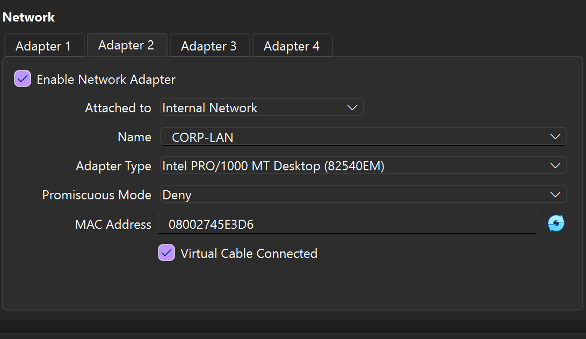
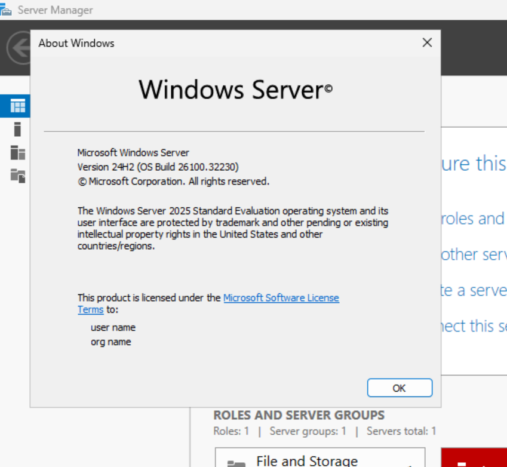
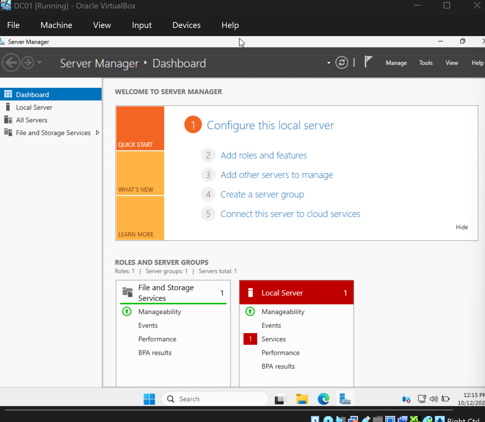
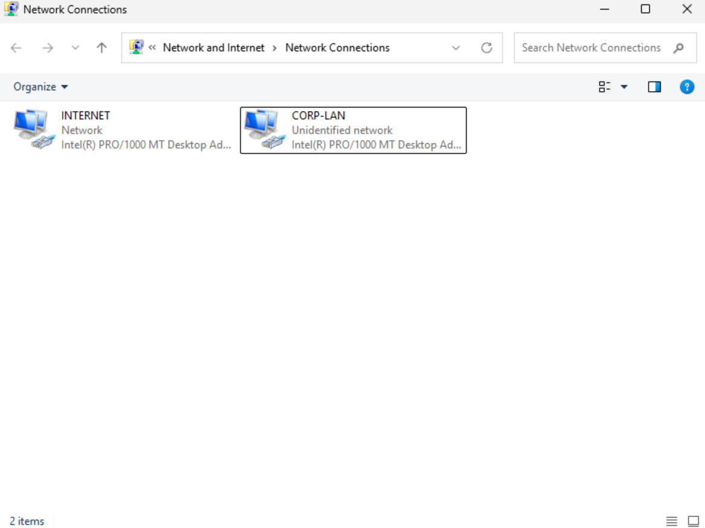
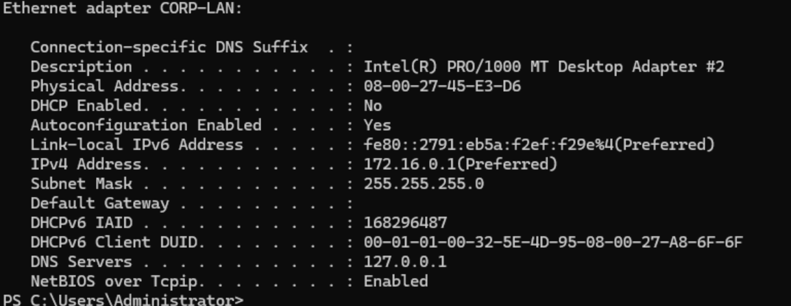
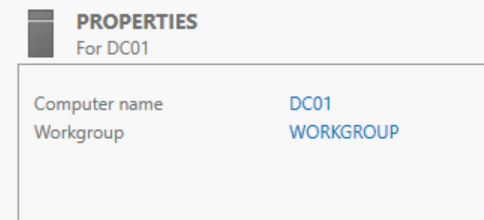
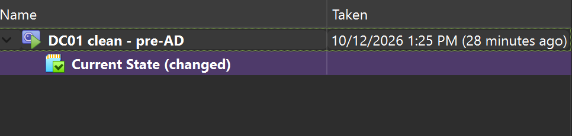

# Phase 1: Building the Domain Controller VM

DC01 is a Windows Server 2025 VM with two network adapters, a static internal address, and a clean snapshot taken before Active Directory is installed.

## 1. Create the VM

I created DC01 in VirtualBox with 2 vCPUs, 4 GB of RAM, and a 60 GB dynamically allocated disk. A domain controller for a small lab is lightweight, and these numbers leave room on the host for client VMs later.

- **Adapter 1: NAT.** DC01's route to the internet, borrowing the host's connection.
- **Adapter 2: Internal Network "CORP-LAN".** A private network that only the lab VMs can see. This is the fictional company's office network.
- **Promiscuous mode: Deny.** The adapter only accepts traffic addressed to it.

## 2. Install Windows Server 2025

I installed **Windows Server 2025 Standard Evaluation (Desktop Experience)**. Server Core (no GUI) is common in production because it has a smaller attack surface, but the GUI is the better choice while learning.

After installing, I added VirtualBox Guest Additions (display, mouse, and clipboard drivers) and turned on file name extensions in File Explorer. Hidden extensions let a file like `invoice.pdf.exe` pass as a PDF.

## 3. Identify and rename the network adapters

`ipconfig` showed one adapter at 10.0.2.15 (the VirtualBox NAT range) and one with a 169.254.x.x address. A 169.254 address is APIPA: Windows assigns it to itself when no DHCP server answers, which fit the internal network having no DHCP server yet. I renamed the adapters **INTERNET** and **CORP-LAN** so routing and DNS settings in later phases can't be applied to the wrong one.

## 4. Set a static IP on CORP-LAN

| Setting | Value | Why |
| --- | --- | --- |
| IP address | 172.16.0.1 | Clients will always look for the DC at this address |
| Subnet mask | 255.255.255.0 | Defines the 172.16.0.0/24 office network |
| Default gateway | Blank | Internet traffic already leaves through the INTERNET adapter |
| DNS server | 127.0.0.1 | DC01 will be the domain's DNS server, so it queries itself |

## 5. Rename the server

I renamed the server from the generated WIN-439M4GGA92S to **DC01** before installing Active Directory. A domain controller's name is written into AD, DNS records, and certificates, so renaming it later is a multi-step process that can break things.

## 6. Snapshot

I took a snapshot named **DC01 clean - pre-AD** as a rollback point before Phase 2. One caveat from production: restoring an old snapshot of a domain controller in a multi-DC environment can corrupt AD replication. It's safe here because the lab has a single DC.

## Troubleshooting

| Symptom | Diagnosis | Fix |
| --- | --- | --- |
| VM started to a black screen with no logo or text | The ISO was attached and display settings were correct. VirtualBox's green turtle icon showed it was running on top of Hyper-V. Disabling UEFI let the VM boot. | Root cause: UEFI boot under Hyper-V in VirtualBox. Installed in legacy BIOS mode. |
| Boot order setting greyed out | The setting applies to BIOS only; UEFI firmware manages its own boot order. | None needed. |
| "Unknown Publisher" warning kept appearing for the ISO | Windows tags downloaded files with the Mark of the Web, and ISO containers carry no signature of their own. | Confirmed the file came from microsoft.com and matched Microsoft's naming, then unblocked it in File Properties. |
| No Right Ctrl key on the laptop, so VirtualBox's Ctrl+Alt+Del shortcut didn't work | Laptop keyboard layout | Sent Ctrl+Alt+Del through Input > Keyboard in VirtualBox. |

## Next

Phase 2 promotes DC01 to a domain controller and sets up DNS, DHCP, and routing for the internal network.
