# Phase 2: Active Directory, DNS, Routing and DHCP

DC01 is now the domain controller for **corp.harborlogistics.internal**. It runs DNS for the domain, forwards internet lookups, routes the office network to the internet with NAT, and hands out addresses with DHCP. Getting DNS right took the most work, and the troubleshooting is documented below.

## 1. Install Active Directory Domain Services

I installed the AD DS role through Add Roles and Features. Installing the role only puts the software on the server; nothing changes on the network until the server is promoted.

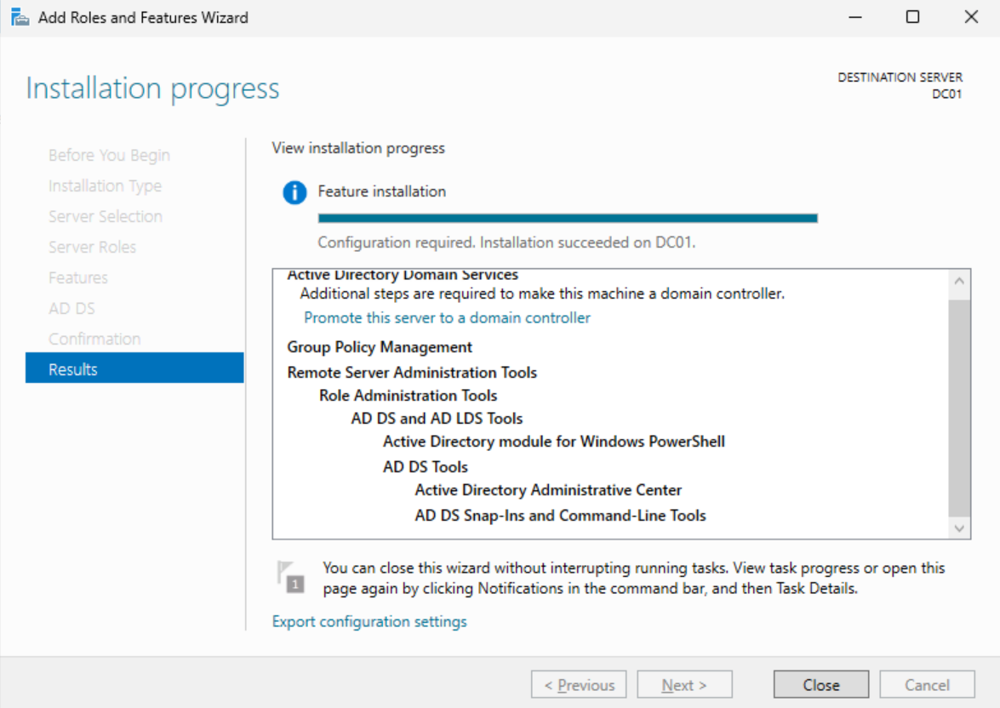

## 2. Promote DC01 to a domain controller

| Setting | Value | Why |
| --- | --- | --- |
| Deployment | New forest | Harbor Logistics had no existing directory |
| Root domain | corp.harborlogistics.internal | .internal is reserved for private networks |
| NetBIOS name | HARBOR | Users see it at login (HARBOR\username); the default "CORP" says nothing about the company |
| Functional level | Windows Server 2025 | No older domain controllers to stay compatible with |
| DNS server / Global Catalog | Yes / Yes | AD depends on DNS to locate domain controllers; the GC indexes the forest for logins and searches |
| DSRM password | Stored in a password manager | Recovery mode for when AD itself is broken |

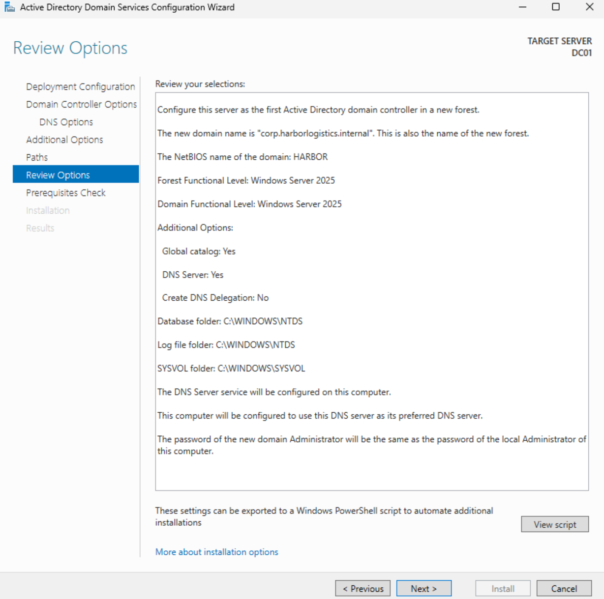

I saved the wizard's generated PowerShell as [`scripts/Install-ADDSForest.ps1`](../scripts/Install-ADDSForest.ps1). It reproduces the same promotion in one command, which is how a second DC or a rebuild would be done consistently.

After the reboot, DC01 belongs to the domain instead of a workgroup:

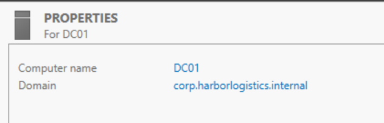

**Security step:** promotion copies the local Administrator password to the new domain Administrator account. Mine was an example password, so I immediately changed it to a generated passphrase stored in a password manager.

## 3. Verify Active Directory

DC01 appears in the Domain Controllers OU as a Global Catalog server. Domain Controllers is an OU, while the default Users and Computers folders are containers that can't have Group Policy linked to them, which is why Phase 4 uses custom OUs.

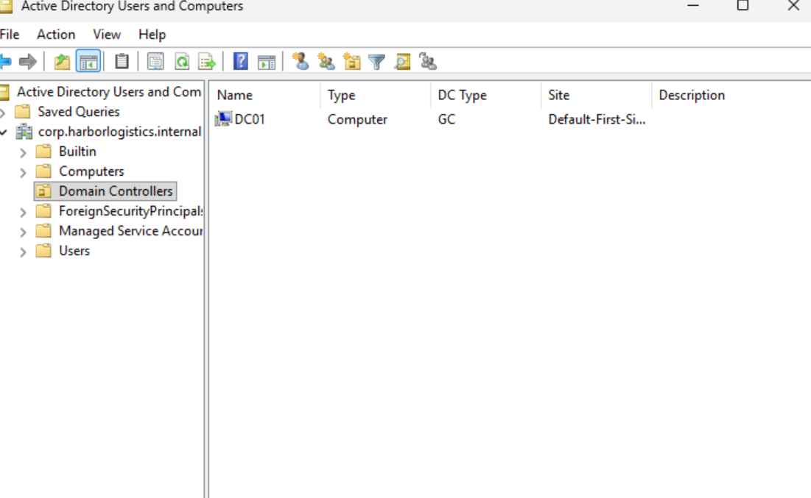

## 4. Fix DNS: the domain controller registered its NAT address

The new DNS zone listed DC01 and the domain name at **both** 172.16.0.1 (CORP-LAN) and 10.0.2.15 (the NAT adapter), plus an IPv6 address from the NAT side.

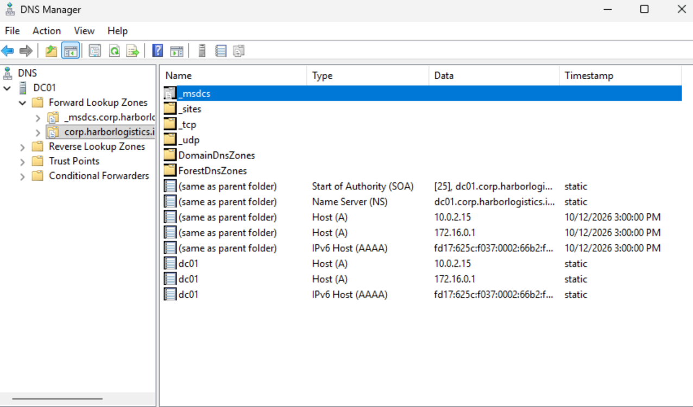

**Why it matters:** DNS hands out multiple records in rotation (round-robin). Workstations on CORP-LAN would get the unreachable NAT address roughly half the time, causing random login, Group Policy and domain-join failures.

**Root cause:** a DC with two network cards registers every address. The network adapter registers the host record, and the Netlogon service separately registers the domain (LDAP) and Global Catalog records for every IP.

**Fix:**
1. Turned off "Register this connection's addresses in DNS" on the INTERNET adapter (IPv4 and IPv6).
2. Restricted the DNS service to listen only on 172.16.0.1.
3. Told Netlogon not to auto-register the domain and GC address records:
   ```powershell
   New-ItemProperty -Path "HKLM:\SYSTEM\CurrentControlSet\Services\Netlogon\Parameters" `
     -Name "DnsAvoidRegisterRecords" -PropertyType MultiString `
     -Value "LdapIpAddress","GcIpAddress" -Force
   Restart-Service Netlogon
   ```
4. Deleted the incorrect records and created static A records for the domain and `gc` pointing to 172.16.0.1.

Steps 1 and 2 alone weren't enough. After them, the `dc01` record was clean, but restarting Netlogon put the domain record back at 10.0.2.15, which is what led to step 3:

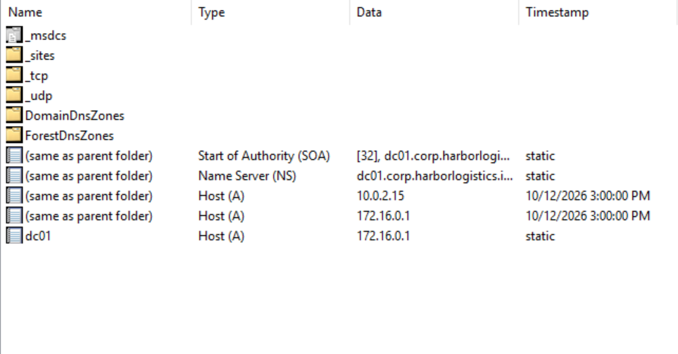

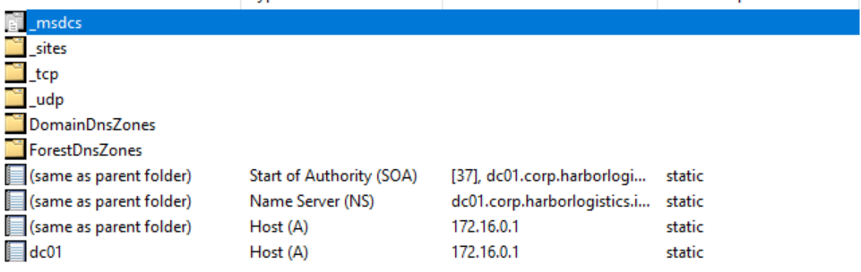

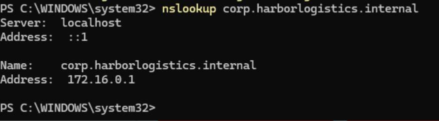

I also set DC01's own DNS client to itself on both adapters (172.16.0.1 first, loopback second on CORP-LAN), so the DC never asks an outside server about its own domain.

## 5. Fix DNS: internet names resolved to the wrong address

`nslookup google.com` from DC01 returned 192.0.0.88, which is not a Google address. Direct queries to outside DNS servers returned errors or timed out.

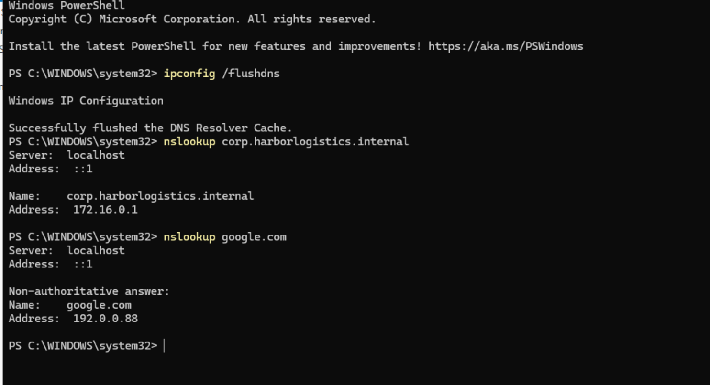

**How I isolated it, one variable at a time:**

| Test | Result | Conclusion |
| --- | --- | --- |
| `Test-NetConnection 1.1.1.1 -Port 443` | Succeeded | Routing and NAT to the internet work |
| DNS query to 1.1.1.1 over UDP and TCP | Timed out / failed | Only DNS (port 53) is affected |
| Same DNS query from the host laptop | Timed out | Not a VM problem; the host's network path |
| Query to the home router with the host VPN on | Timed out | VPN blocks access to the local network |
| Query to the home router with the VPN off | 142.251.219.46 (correct) | VPN was blocking it |

**Second root cause:** promotion had copied the server's adapter DNS servers (the host VPN's resolvers) into the DNS **Forwarders** list. DC01 was forwarding internet lookups to the VPN's DNS, which returned 192.0.0.88.

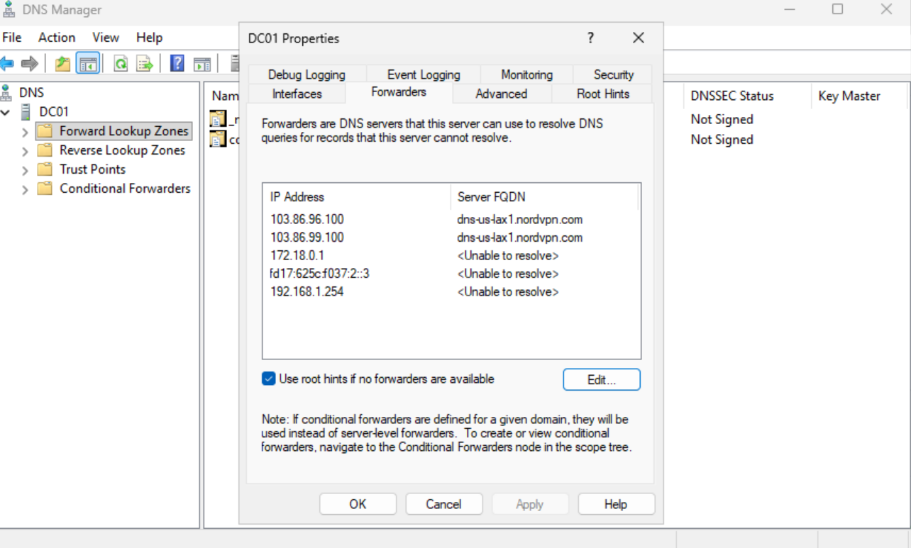

**Fix:** removed the inherited forwarders and set the router (192.168.1.254) as the only forwarder, with root hints as a fallback.

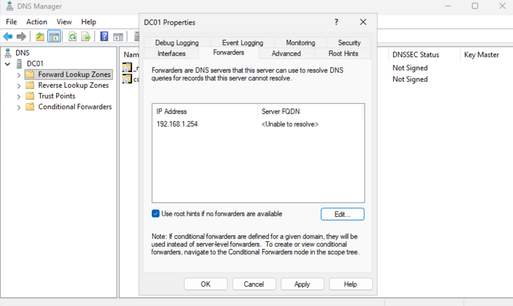

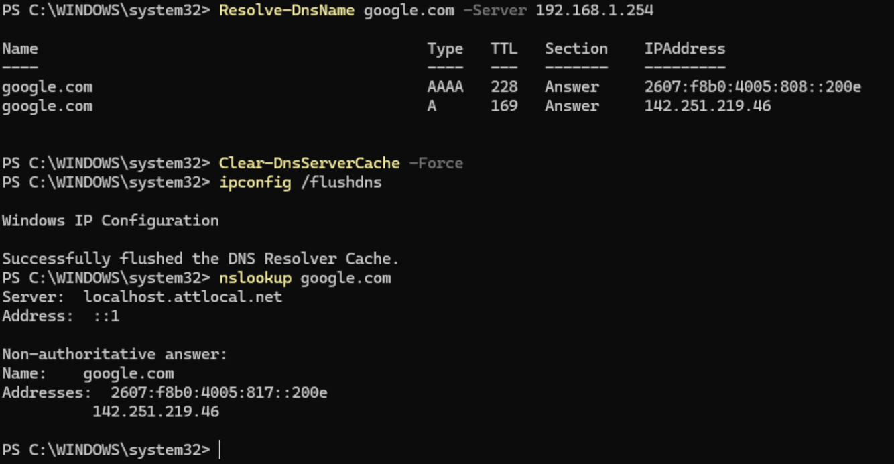

**Lesson:** I changed Wi-Fi networks partway through testing, which mixed results from two environments. Keeping the environment fixed while testing would have isolated the cause faster.

**Known limitation:** the forwarder only works on this network, and the host VPN must be off (or allow LAN access) while labbing.

## 6. Routing and NAT

Workstations on CORP-LAN have no direct internet access by design. I installed Routing and Remote Access (RRAS) and configured **NAT** with INTERNET as the public interface, so DC01 translates workstation traffic out through its NAT adapter.

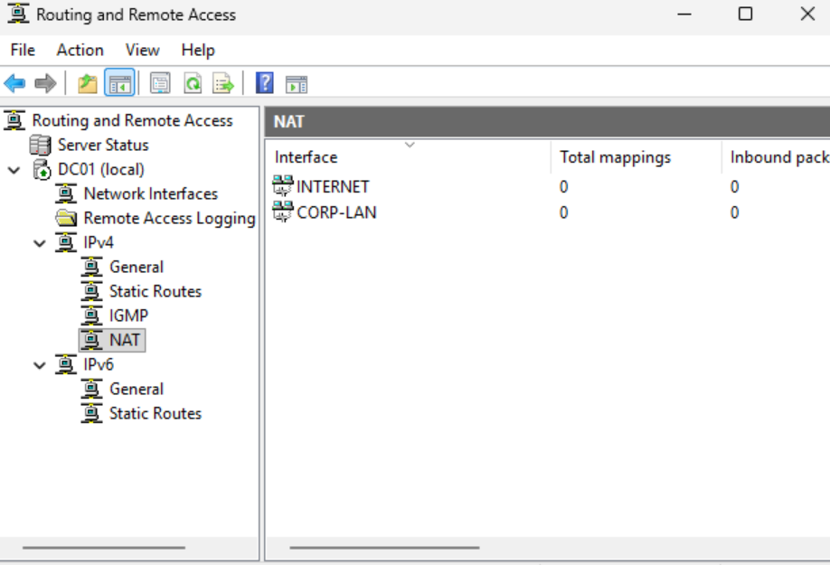

**Security notes:**
- Installing the Remote Access role pulled in IIS (a web server) and Windows Internal Database as dependencies. Every extra service is added attack surface on the most sensitive server in the domain.
- In production, routing and NAT belong on a dedicated router or firewall, not a domain controller. It's combined here only because the lab has one server.

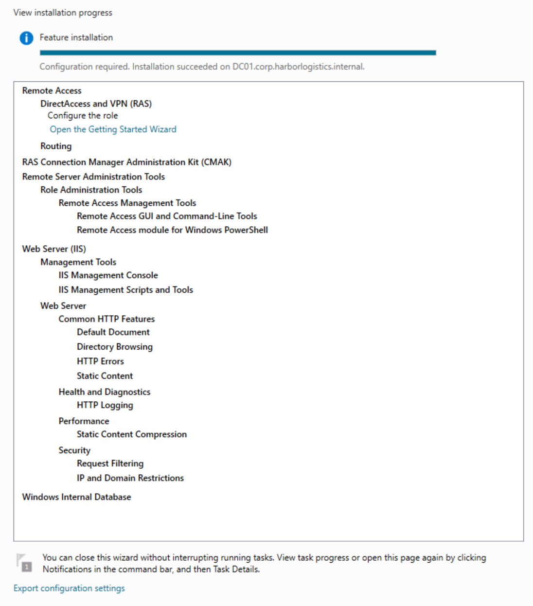

## 7. DHCP

I installed the DHCP Server role and completed the post-install configuration, which creates the DHCP Administrators and DHCP Users groups (least privilege for help desk staff) and **authorizes** the server in AD. Authorization stops rogue DHCP servers from handing out addresses on the domain.

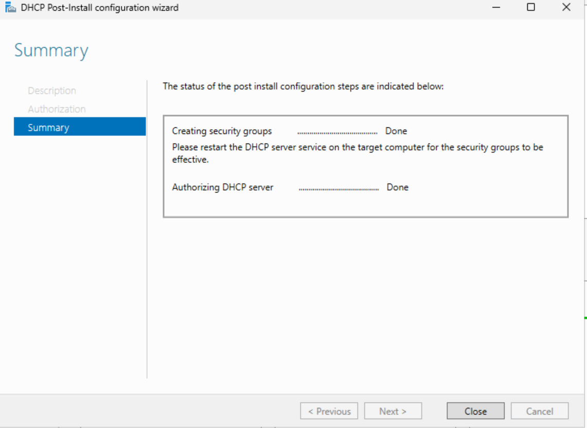

| Scope setting | Value | Why |
| --- | --- | --- |
| Name | HQ - CORP-LAN | Matches the network it serves |
| Range | 172.16.0.100 to 172.16.0.200 | Leaves .1 to .99 for servers and fixed devices |
| Lease | 8 days | Office desktops rarely change |
| 003 Router | 172.16.0.1 | DC01's NAT routes traffic out |
| 006 DNS Servers | 172.16.0.1 only | Clients must use the DC's DNS to find the domain |
| 015 DNS Domain Name | corp.harborlogistics.internal | Lets clients resolve short names |

While setting the DNS option, I caught a typo (172.160.0.1) in the list. That is a public internet address, not part of the lab; handing it to every client would send their DNS queries to a stranger.

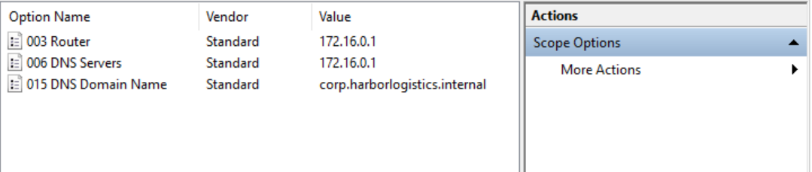

## Next

Phase 3 builds a Windows 11 workstation on CORP-LAN, which should get its address from DHCP, reach the internet through NAT, and join the domain.
