# Phase 3: Windows 11 Client and Domain Join

WS01 is a Windows 11 Enterprise workstation on the office network only. It got its address from DC01's DHCP, reached the internet through DC01's NAT, joined **corp.harborlogistics.internal**, and a domain user logged in authenticated by DC01. Getting there exposed a misconfigured RRAS NAT setup from Phase 2, which I isolated and fixed.

## 1. Build WS01

| Setting | Value | Why |
| --- | --- | --- |
| OS | Windows 11 Enterprise (evaluation) | Home editions can't join a domain |
| CPU / RAM / Disk | 2 vCPU / 4 GB / 64 GB | Windows 11 minimums (disk resized from 60 GB before install) |
| Network | Internal Network **CORP-LAN only**, no NAT adapter | Forces WS01 to depend on DC01 for addresses, DNS and internet, which is the point of the test |

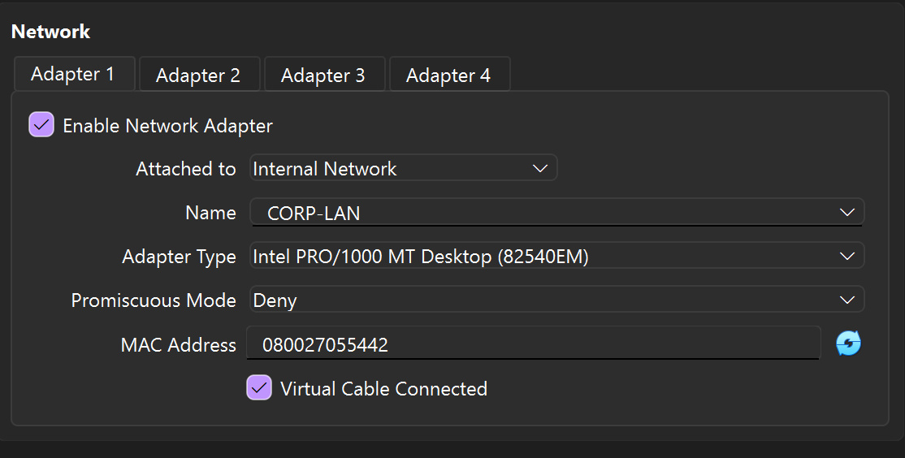

## 2. Windows 11 hardware checks

Windows 11 requires UEFI, TPM 2.0 and Secure Boot. With those enabled, WS01 booted to a black screen, the same failure DC01 had in Phase 1. Two machines with the same symptom confirmed the cause: VirtualBox can't boot UEFI guests while the host runs Hyper-V (used by Windows' Memory Integrity / VBS).

**Options I weighed:**

| Option | Trade-off | Decision |
| --- | --- | --- |
| Disable Memory Integrity on the host | Lowers the real laptop's security to make a practice VM more realistic | Rejected |
| Move the lab to Hyper-V Gen 2 VMs | Native UEFI, Secure Boot and vTPM, but requires rebuilding DC01 | Planned as a later phase |
| Legacy BIOS plus setup-time bypass | VM runs without Secure Boot/TPM, acceptable for an isolated lab | Used now |

During setup (Shift+F10), I added the two documented lab bypass values and verified them:

```
reg add HKLM\SYSTEM\Setup\LabConfig /v BypassTPMCheck /t REG_DWORD /d 1 /f
reg add HKLM\SYSTEM\Setup\LabConfig /v BypassSecureBootCheck /t REG_DWORD /d 1 /f
```

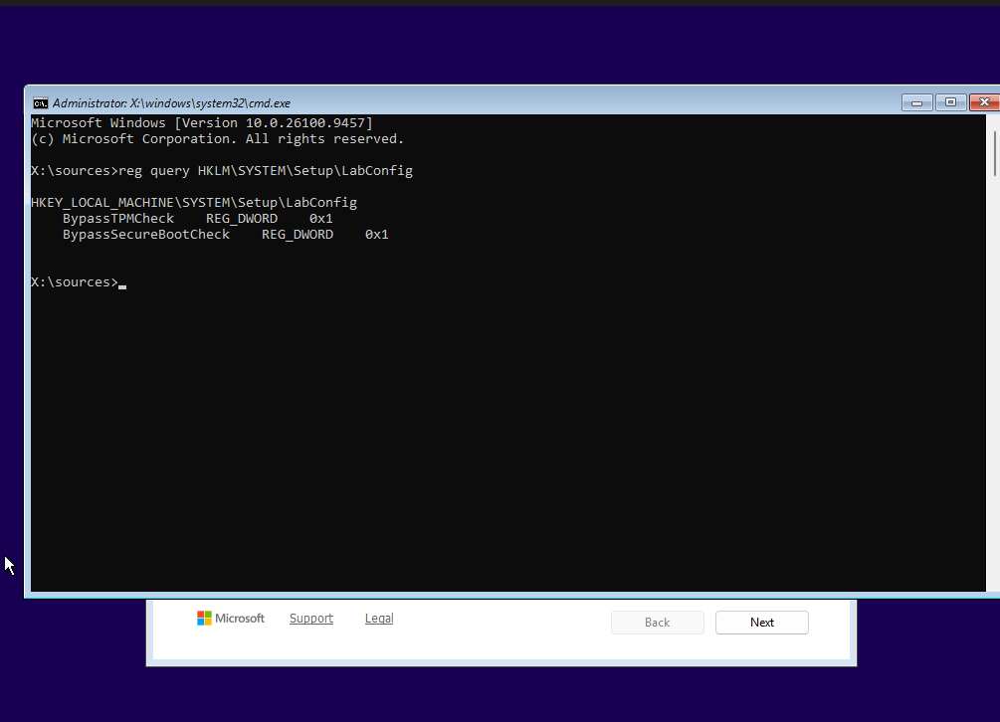

These values live in the installer's in-memory registry, so they had to be re-entered after a power-off. In production I would not bypass these checks; TPM and Secure Boot defend against boot-level malware and offline data theft.

I created a local account (`localadmin`) only for setup and emergency access, and turned off all optional telemetry during setup. In production each workstation's local admin password would be unique and rotated with Windows LAPS.

## 3. DHCP worked

WS01's first lease came from DC01 with every option I configured in Phase 2:

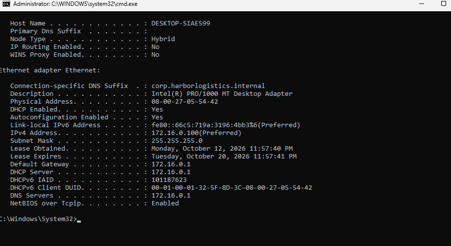

| Value | Source |
| --- | --- |
| 172.16.0.100 | First address in the DHCP pool |
| Gateway 172.16.0.1 | Option 003 |
| DNS 172.16.0.1 | Option 006 |
| DNS suffix corp.harborlogistics.internal | Option 015 |
| 8-day lease | Scope setting |

## 4. Troubleshooting: DNS and internet failed from the client

**Symptom:** Windows setup reported "No internet," and `nslookup` from WS01 to DC01 timed out completely.

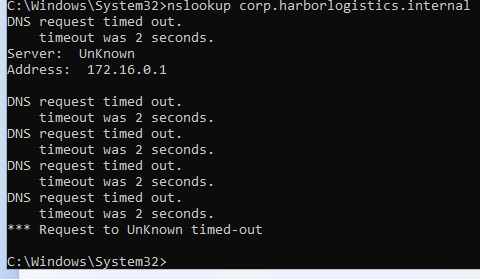

I worked through the chain from the client outward, ruling out one thing at a time:

| Check | Result | Conclusion |
| --- | --- | --- |
| WS01 address | 172.16.0.100 from DC01 | Client-to-DC connectivity and DHCP work |
| DC01 DNS forwarder | Pointed at the previous network's router | Fixed (internet names only; doesn't explain internal lookups failing) |
| DC01 network profiles | Both DomainAuthenticated | Not a firewall-profile mix-up |
| DNS Server service | Running | Not a stopped service |
| DC01 querying its own 172.16.0.1 | Answered | DNS server works locally |
| Windows Firewall off (briefly, isolated lab, then re-enabled) | Still failed | Not the host firewall |
| RRAS (RemoteAccess service) stopped | **Answered instantly** | RRAS is blocking client traffic |

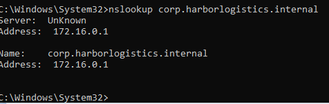

**Root cause:** the Phase 2 NAT wizard had the interface roles **swapped**. CORP-LAN was configured as the public, NAT-enabled interface, so RRAS treated the office network as the internet and filtered traffic arriving from it. INTERNET was public with NAT turned off, so client traffic could never have been translated out.

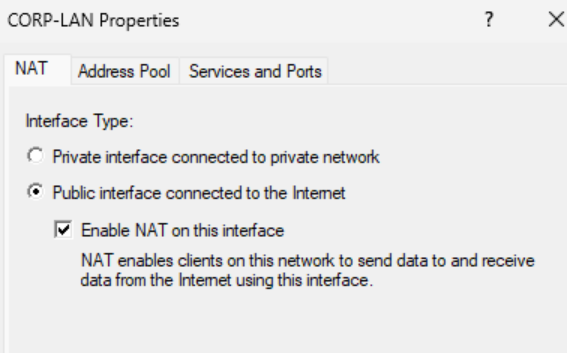

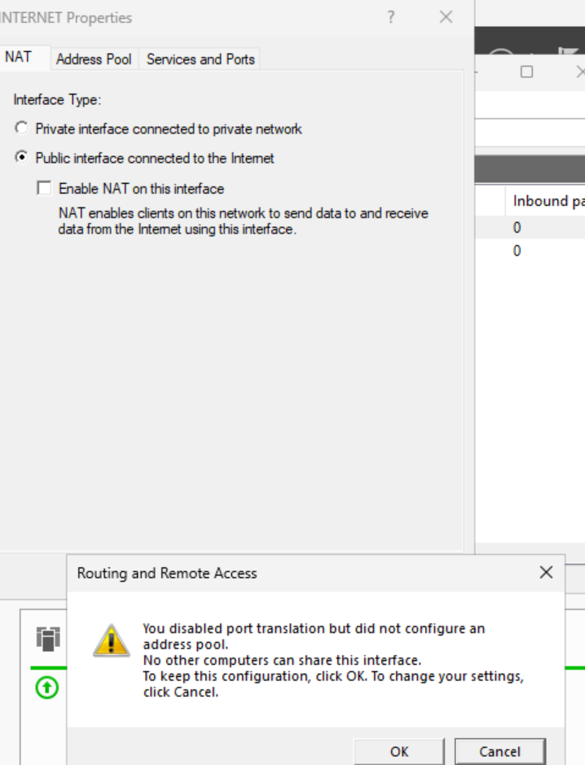

**Fix:** set CORP-LAN to "Private interface connected to private network," enabled NAT on INTERNET, and restarted RemoteAccess.

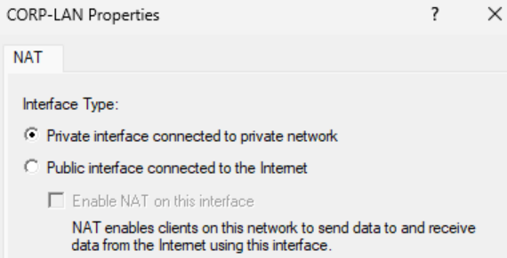

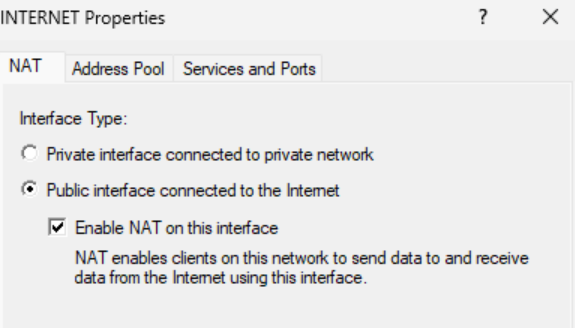

**Verified from WS01:** internal and internet names resolve through DC01, and HTTPS traffic reaches the internet through NAT.

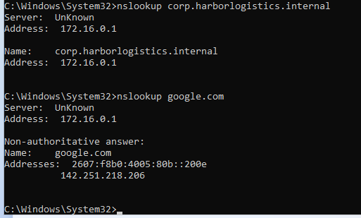

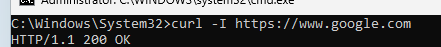

**Lessons:**
- A wizard only does what you click. The NAT misconfiguration sat unnoticed through Phase 2 because nothing used it until a real client did; testing from an actual workstation caught it.
- Stopping one component at a time (firewall, then RRAS) found the cause in minutes instead of guessing at settings.

## 5. Create the first domain user

In ADUC I created **Jordan Reyes** (`jreyes`, `HARBOR\jreyes`) with a temporary password and **User must change password at next logon**, the same onboarding flow a help desk uses so IT never knows the user's real password. Usernames follow a first-initial + last-name convention.

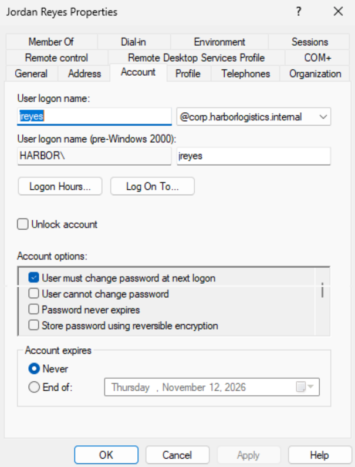

## 6. Join the domain

Through `sysdm.cpl` I renamed the computer to **WS01** and joined **corp.harborlogistics.internal** using domain admin credentials. Joining requires WS01 to locate the domain controller through DNS, so this step also confirmed the RRAS fix. `Test-ComputerSecureChannel` returning **True** confirms the trust relationship between WS01 and DC01.

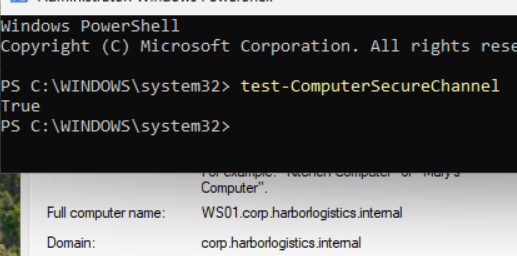

## 7. Log in as a domain user

Jordan logged in to WS01, was forced to change the temporary password, and Windows built the profile. DC01 authenticated the login:

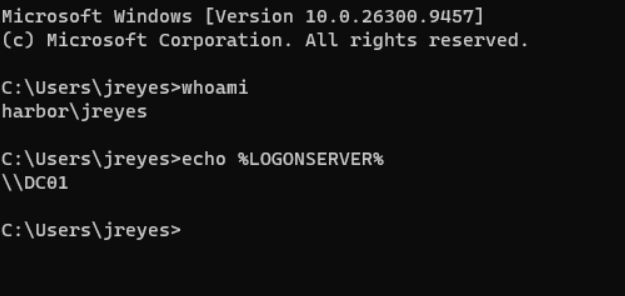

`harbor\jreyes` is a domain account, and `\\DC01` is the domain controller that verified the password.

## Result

| Phase 2 component | Proven by |
| --- | --- |
| DHCP | WS01 received 172.16.0.100 and all scope options |
| DNS | WS01 resolved the domain and internet names through 172.16.0.1 |
| NAT routing | WS01 reached google.com over HTTPS through DC01 |
| Active Directory | WS01 joined the domain; jreyes logged in, authenticated by DC01 |

## Next

Phase 4 builds out Harbor Logistics: department OUs, users and groups (with PowerShell bulk creation), Group Policy, file shares with group-based permissions, and mock help desk tickets.
