# Phase 4: OUs, Users, Groups, Group Policy and Help Desk Tickets

Phase 4 turns an empty domain into a working company: an OU structure that mirrors Harbor Logistics' departments, users created in bulk with PowerShell, group-based file share permissions, Group Policy for passwords, drives and workstation security, a separate admin account, and four mock help desk tickets worked from report to fix.

## 1. OU structure

Organizational units (OUs) are folders in Active Directory that control **which Group Policies apply** and **who can manage what**. The default `Users` and `Computers` containers can't have GPOs linked to them, so everything lives under a top-level `Harbor` OU.

```
Harbor
├── Users
│   ├── IT
│   ├── HR
│   └── Finance
├── Groups
├── Computers
│   └── Workstations
└── Admins
```

All OUs are protected from accidental deletion.

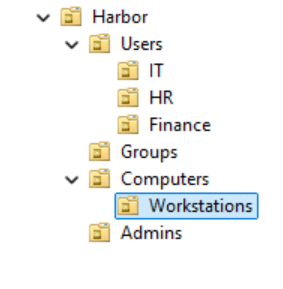

I moved the existing user (jreyes) to `Harbor\Users\Finance` and WS01 to `Harbor\Computers\Workstations`. So that newly joined computers don't land in the default container, I redirected it:

```powershell
redircmp "OU=Workstations,OU=Computers,OU=Harbor,DC=corp,DC=harborlogistics,DC=internal"
```

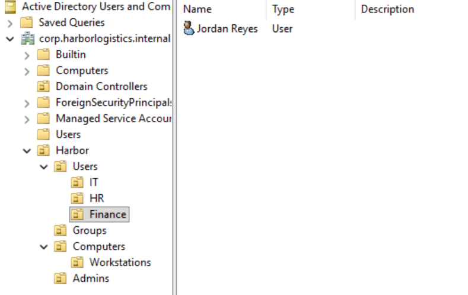

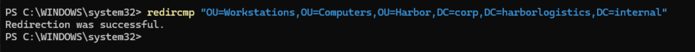

## 2. Department groups

One global security group per department (`GG-IT`, `GG-HR`, `GG-Finance`) in `Harbor\Groups`. Users go into groups; permissions are given to groups, never to individual users.

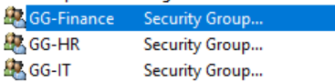

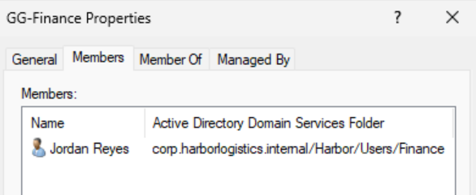

## 3. Bulk user creation with PowerShell

[`scripts/New-HarborUsers.ps1`](../scripts/New-HarborUsers.ps1) reads [`scripts/harbor-users.csv`](../scripts/harbor-users.csv) and, for each row:

- checks that the department has an OU and a `GG-<Dept>` group (skips the row if not)
- skips people who already have an account, so it's safe to run again
- builds the username as first initial + last name, adding a number on a collision (`jreyes` exists, so Jamie Reyes became `jreyes2`)
- creates the account in the department OU with a temporary password and **must change password at next logon**
- adds the user to the department group

The temporary password is prompted once with `Read-Host -AsSecureString`; no password is stored in the script, the CSV or the repo. The script supports `-WhatIf`, so I previewed every change before making it.

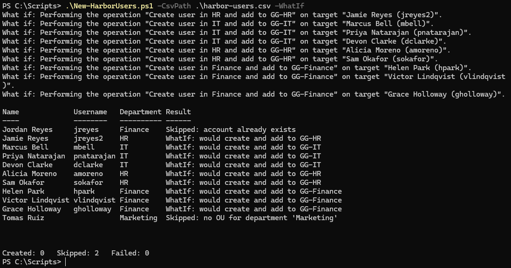

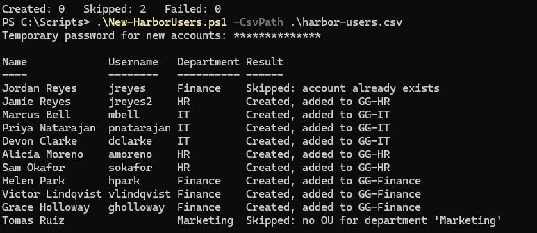

Result: 9 users created, 2 rows skipped on purpose (Jordan Reyes already existed; the Marketing row had no OU), 0 failures.

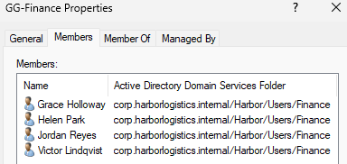

## 4. Password and lockout policy

Set in the Default Domain Policy, which is where domain password policy has to live:

| Setting | Value | Why |
| --- | --- | --- |
| Minimum length | 14 | Length matters more than complexity against cracking |
| Complexity | Enabled | Blocks the simplest passwords |
| History | 24 | Stops users cycling back to an old password |
| Maximum age | 365 days | Long-lived passwords paired with length, in line with current NIST guidance against frequent forced changes |
| Minimum age | 1 day | Stops users changing 24 times in a row to get back to their old password |
| Lockout threshold | 5 attempts | Stops online password guessing |
| Lockout duration / reset | 15 min / 15 min | Locks out attackers without needing the help desk for every typo |

```powershell
Get-ADDefaultDomainPasswordPolicy
```

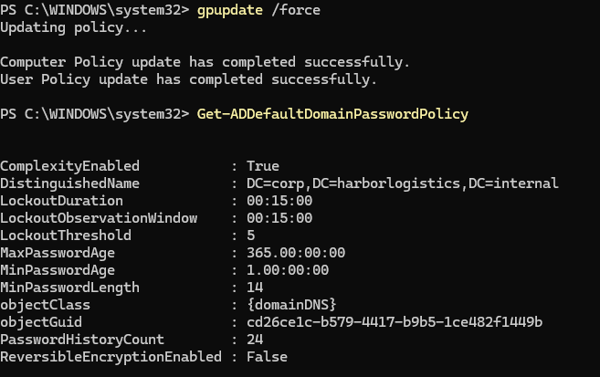

## 5. Department file share with AGDLP

[`scripts/New-HarborShares.ps1`](../scripts/New-HarborShares.ps1) builds `\\DC01\Departments` with a folder per department, using **AGDLP**: **A**ccounts go in **G**lobal groups, global groups go in **D**omain **L**ocal groups, and domain local groups get **P**ermissions.

```
jreyes → GG-Finance → DL-Share-Finance-Modify → Modify on Departments\Finance
```

The global group says *who you are* (Finance). The domain local group says *what you can do* (modify the Finance folder). Moving someone between departments is one group change, and every permission on the folder can be explained by a group name.

- Each department folder has inheritance removed: SYSTEM and Administrators Full Control, the DL group Modify.
- Share permissions are broad (Authenticated Users: Change); NTFS permissions do the real access control.
- **Access-Based Enumeration** hides folders a user can't open, so users only see their own department.

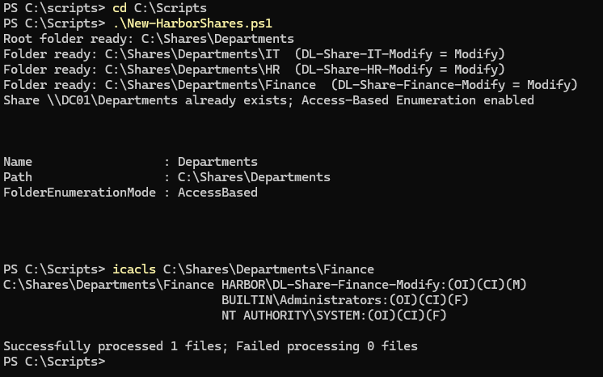

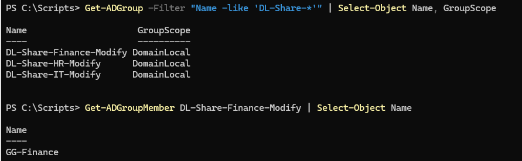

Tested as jreyes on WS01: only Finance is visible, a new file can be created in it, and `whoami /groups` shows both GG-Finance and DL-Share-Finance-Modify.

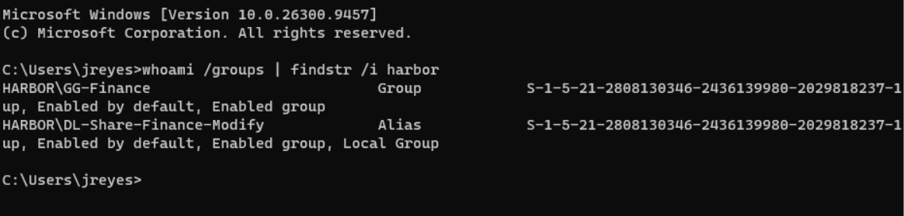

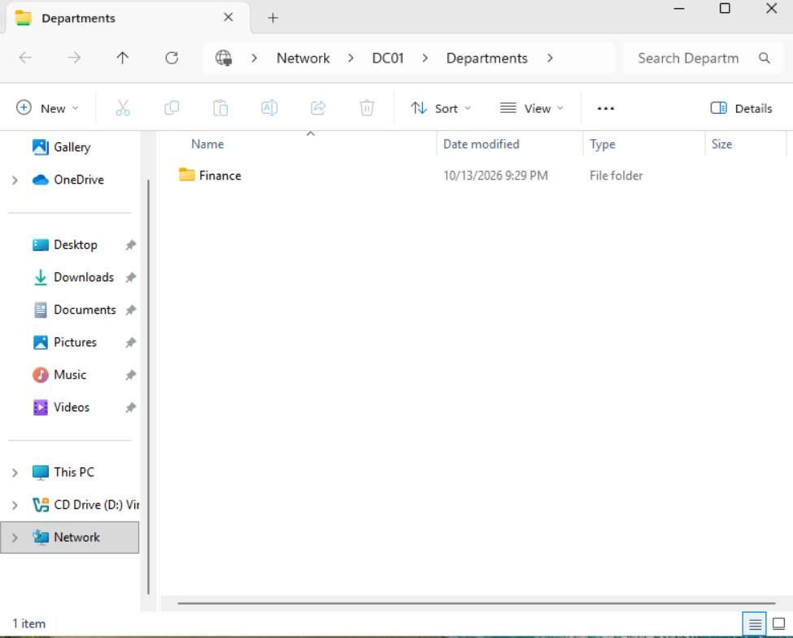

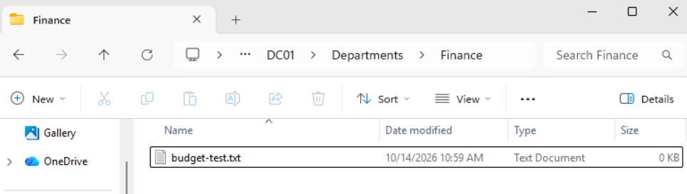

## 6. Group Policy

GPO names follow `Harbor - <User|Computer> - <purpose>`, so the name says where it's linked and which half of the policy it uses.

### Harbor - User - Drive Maps (linked to Harbor\Users)

Maps **S:** to `\\DC01\Departments`, labeled "Departments." Because of ABE, everyone gets the same drive but sees only their department.

The mapping uses the **Replace** action with **"Remove this item when it is no longer applied"** enabled. I added that after Ticket 004 showed a mapping left behind on a user who had moved out of the OU (see below).

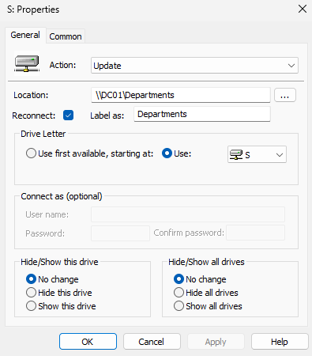

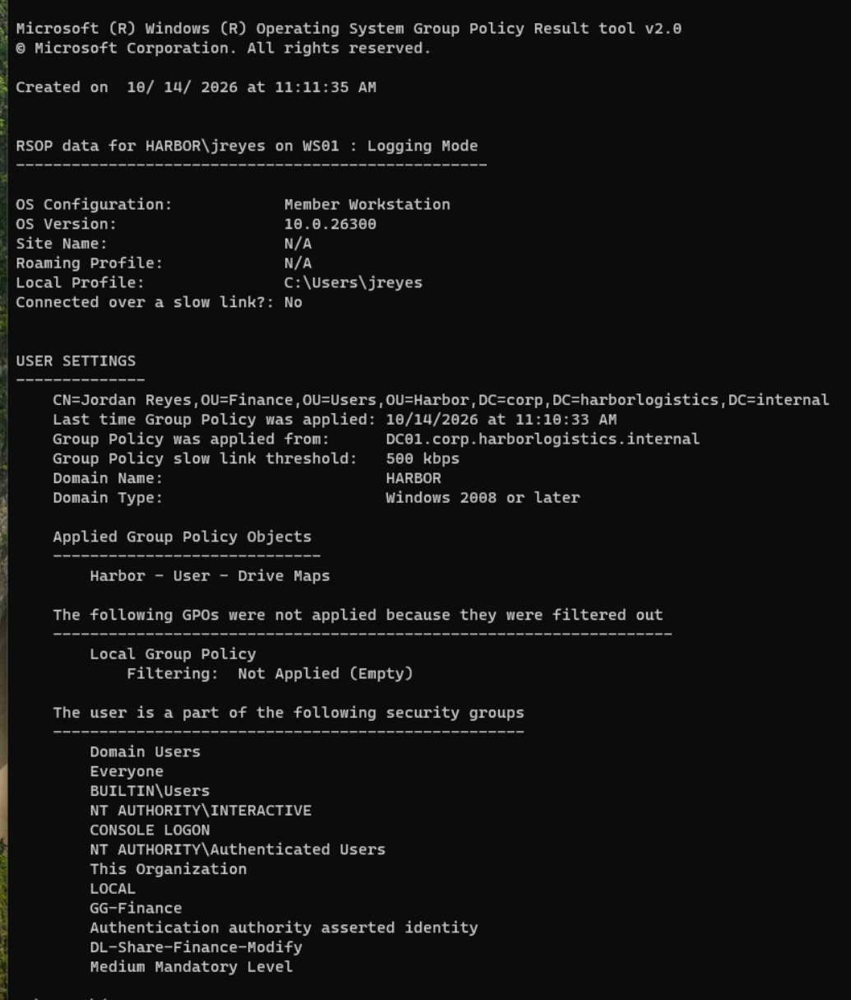

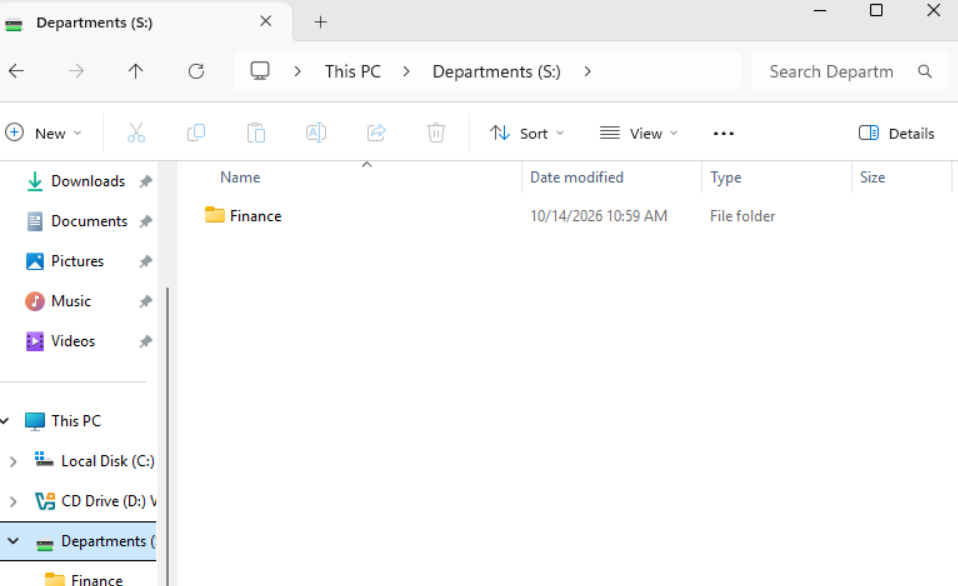

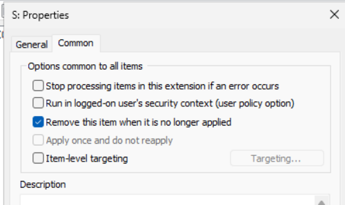

### Harbor - Computer - Workstation Security (linked to Harbor\Computers\Workstations)

A computer policy follows the machine no matter who signs in.

| Setting | Value | Why |
| --- | --- | --- |
| Machine inactivity limit | 900 seconds | An unattended, unlocked PC is open to anyone walking by |
| Don't display last signed-in | Enabled | An attacker at the login screen has to guess the username too |
| Logon message title and text | "Harbor Logistics - Authorized Use Only" | Legal notice that the system is for authorized use and may be monitored |

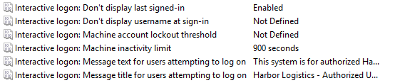

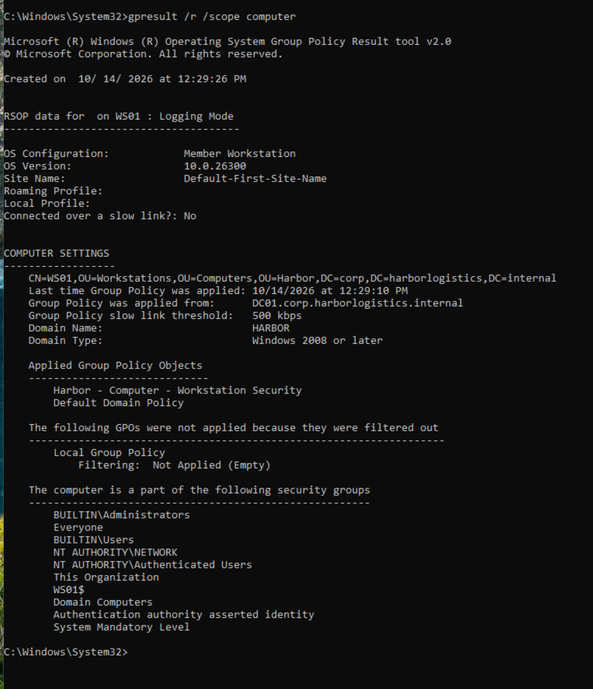

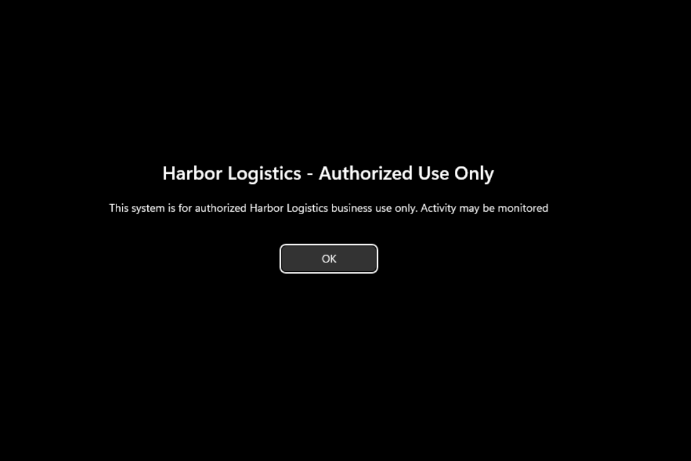

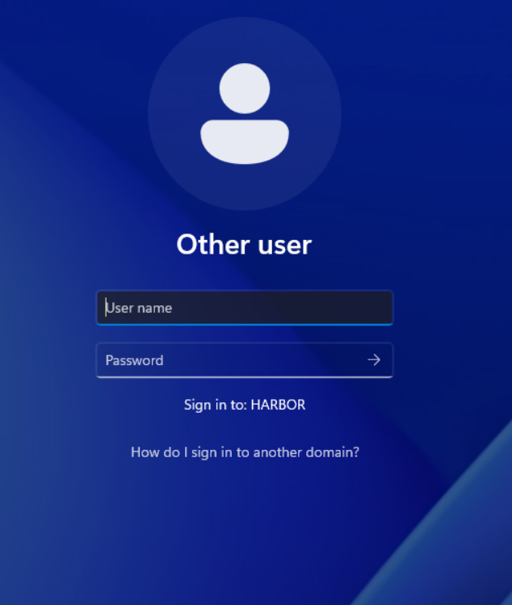

## 7. Separate admin account

Daily admin work moved off the built-in Administrator account to `adm-mmitchell` in `Harbor\Admins`, a member of Domain Admins. The built-in Administrator is kept as a break-glass account. Separating admin accounts from everyday ones (least privilege) means a phishing email opened during normal work doesn't hand over the domain.

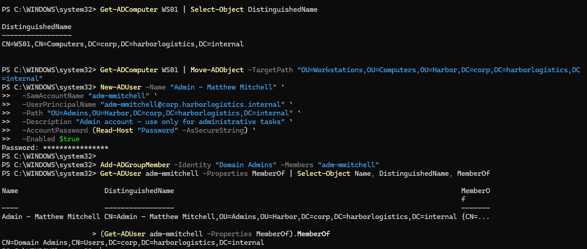

## 8. Help desk tickets

Each ticket was broken on purpose, reproduced as the user, diagnosed, fixed and verified. Full write-ups:

| # | Ticket | What it shows |
| --- | --- | --- |
| [001](../tickets/001-account-lockout.md) | Account locked out | Unlocking only after checking event 4740 for the source, to tell a typo from an attack |
| [002](../tickets/002-password-reset.md) | Forgotten password | Identity verification before a reset; temporary password with forced change |
| [003](../tickets/003-share-access.md) | Can't see department folder | Following the AGDLP chain link by link; fixing through the group, not the folder |
| [004](../tickets/004-gpo-not-applying.md) | Mapped drive missing | OUs control policy, groups control access; found and fixed a leftover drive mapping |

## 9. Troubleshooting

**Group memberships missing from the login token.** After the AGDLP setup, `whoami /groups` for jreyes showed no HARBOR groups, though AD showed him in GG-Finance. I ruled out a cached logon (`LOGONSERVER` = `\\DC01`) and a broken secure channel (`nltest /sc_query` returned `NERR_Success`). Cause: the access token is built at sign-in, and this session predated the group change. A full sign-out and sign-in fixed it. This is the real-world "I was added to the group but still can't open the folder."

**New computer GPO wasn't applying.** `gpresult /r /scope computer` listed only the Default Domain Policy and showed WS01 in the default `CN=Computers` container. Two problems stacked up. First, the report was over an hour old: `gpupdate` had never run, because the elevation prompt failed (`Administrator` points at WS01's disabled local account; the domain account is `HARBOR\Administrator`). Second, `Get-ADComputer WS01` on DC01 confirmed WS01 really was still in `CN=Computers`, so the GPO linked to Workstations could never reach it. I moved it with `Move-ADObject`, ran `gpupdate /force`, and the next report showed WS01 in the Workstations OU with the new GPO applied. Lessons: check a report's timestamp before trusting it, and confirm where an object actually lives instead of assuming an earlier move worked.

**SYSVOL permissions warning in GPMC.** GPMC reported that a GPO's SYSVOL permissions didn't match Active Directory. I let it sync SYSVOL to AD, then re-verified the password policy with `Get-ADDefaultDomainPasswordPolicy`.

## Next

Phase 5: security monitoring. Audit policy, Sysmon, forwarding logs to a SIEM, then simulated attacks (including password spraying against the lockout policy above) and the detections that catch them.
