# Phase 5: Security Logging, Sysmon and a SIEM

Phase 4 built Harbor Logistics as a working company. Phase 5 answers a different question: **if something went wrong on this network, would anyone know?** By default, Windows records very little, and no one is watching what it does record. This phase turns on detailed logging, adds Sysmon for richer detail, stands up a Wazuh SIEM to collect everything in one place, and proves the whole pipeline works by generating a failed-logon event and watching the SIEM correlate it across two machines.

The design goal throughout: **log enough to investigate an incident, forward it somewhere an attacker can't quietly erase it, and surface the events that matter as alerts.**

## 1. Audit policy (Group Policy)

Out of the box, Windows auditing is thin. A GPO linked to both the Domain Controllers OU and `Harbor\Computers\Workstations` turns on the Advanced Audit Policy subcategories that matter for detection, so DC01 and WS01 log the same way.

| Category / subcategory | Setting | Catches |
| --- | --- | --- |
| Account Logon → Credential Validation | Success + Failure | Password guessing |
| Account Logon → Kerberos Authentication Service | Success + Failure | Domain logon attempts |
| Account Logon → Kerberos Service Ticket Operations | Success + Failure | Service-ticket abuse |
| Account Management → User Account Management | Success + Failure | Accounts created, reset, unlocked |
| Account Management → Security Group Management | Success + Failure | Someone added to Domain Admins |
| Logon/Logoff → Logon | Success + Failure | Who logged in where (4624 / 4625) |
| Logon/Logoff → Account Lockout | Success + Failure | Lockouts (4740) |
| Logon/Logoff → Special Logon | Success | Admin-level logons |
| Detailed Tracking → Process Creation | Success | Every program that runs (4688) |
| Policy Change → Audit Policy Change | Success + Failure | An attacker turning logging off |

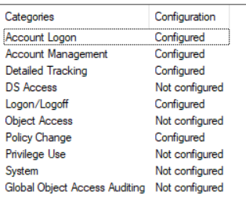

Three more settings in the same GPO make those logs actually useful:

- **Force audit policy subcategory settings to override** — makes the detailed audit settings win over the old basic ones.
- **Include command line in process creation events** — event 4688 records the full command line, not just `powershell.exe`.
- **Turn on PowerShell Script Block Logging** — event 4104 records the actual code PowerShell ran, even if it's encoded or obfuscated.
- **Maximum security log size 1 GB** — so a busy day of logging doesn't overwrite yesterday's evidence.

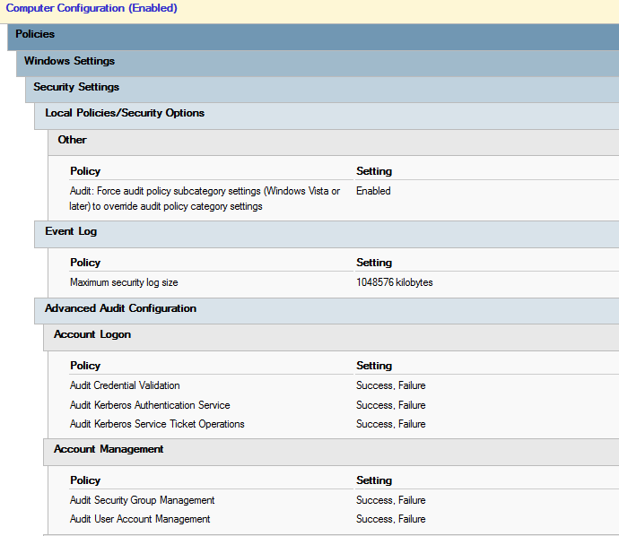

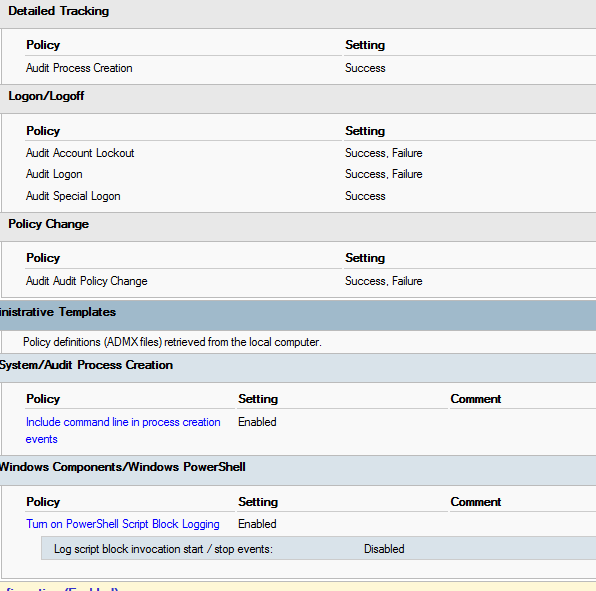

The GPO is linked to both the Domain Controllers OU and the Workstations OU:

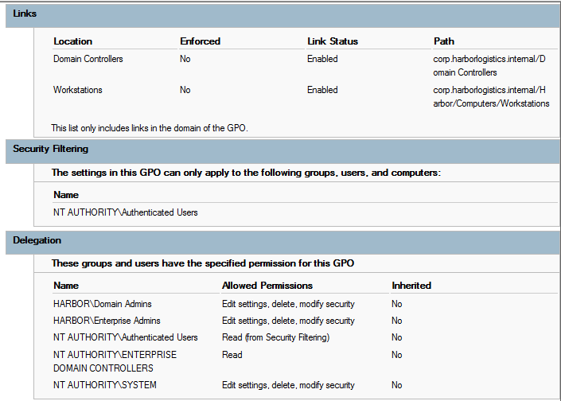

### Verification

`auditpol /get /category:*` shows what Windows is **actually** logging, which can differ from what the GPO says. DC01 and WS01 matched exactly.

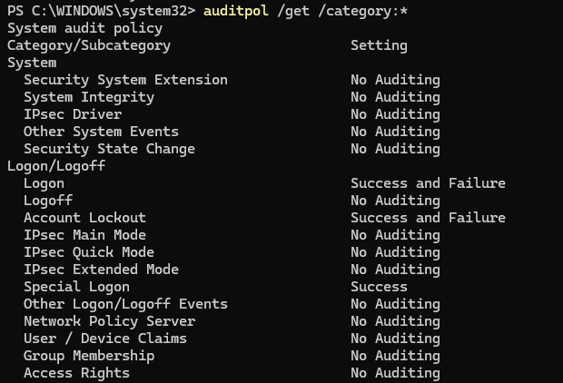

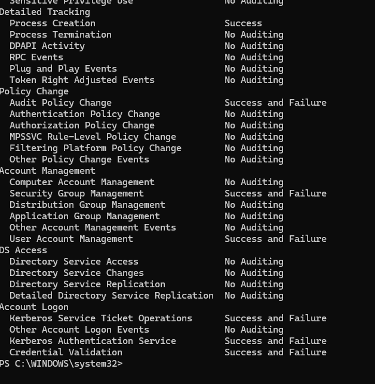

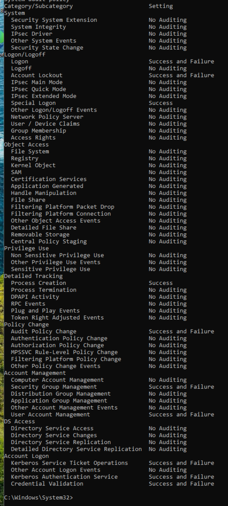

`auditpol` doesn't show the command-line or PowerShell settings, so I tested those directly: ran `whoami /groups` and `Get-ADUser jreyes`, then found them in the logs.

- **Event 4688** recorded the full command line `"C:\Windows\system32\whoami.exe" /groups`, with `powershell.exe` as the parent process.

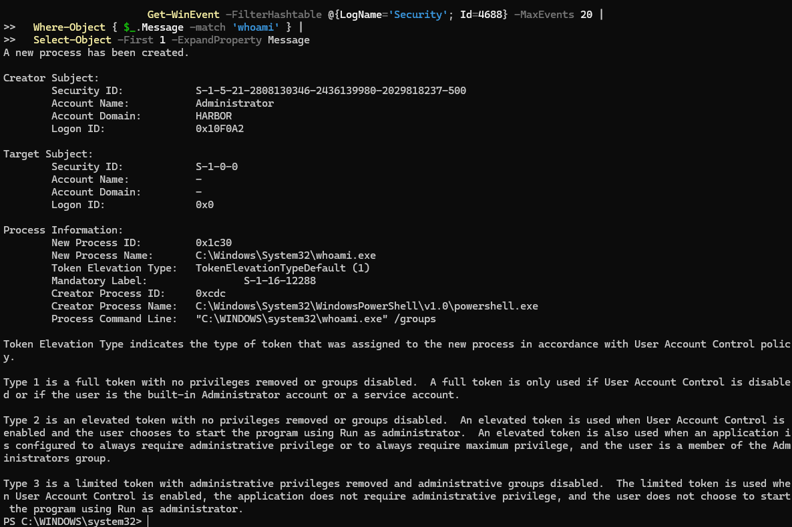

- **Event 4104** recorded `Get-ADUser jreyes` as the script block that ran.

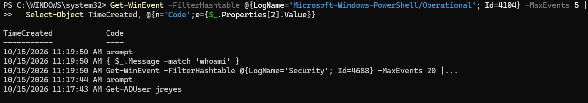

**Side finding:** the 4688 event showed the account as the built-in Administrator (SID ending in `-500`, Token Elevation Type 1, no UAC restriction). That confirmed I had been working as the wrong account. From here on, daily admin work moved to `adm-mmitchell`.

## 2. Sysmon

Windows auditing says *that* a program ran. **Sysmon** (System Monitor, a free Microsoft Sysinternals tool) adds detail Windows doesn't: the file's hash, the parent process, and network connections.

Downloaded from `download.sysinternals.com` with PowerShell (a domain controller shouldn't browse the web), verified the signature before running it, and installed with the widely used **SwiftOnSecurity** config, which keeps the useful events and filters normal Windows noise.

```powershell
Get-AuthenticodeSignature .\Sysmon64.exe | Select-Object Status, Signer   # Valid, Microsoft Corporation
.\Sysmon64.exe -accepteula -i .\sysmonconfig.xml
```

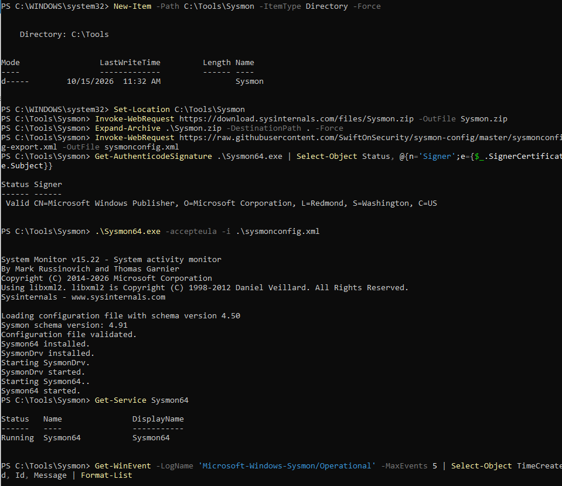

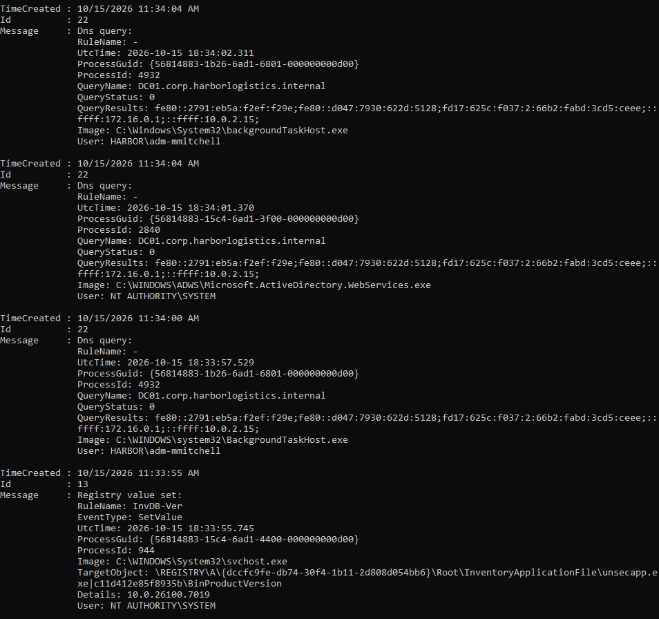

On WS01 I copied the same `Sysmon64.exe` and config from `\\DC01\C$\Tools\Sysmon` instead of downloading again, so both machines run the identical version and ruleset.

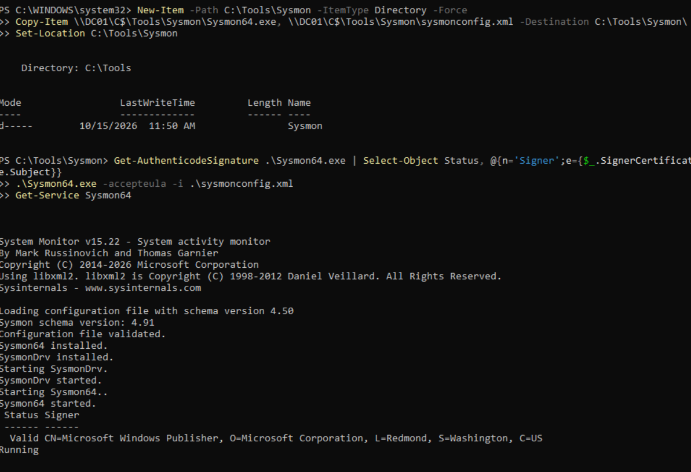

Sysmon's process-creation event (**Event ID 1**) is its version of 4688, but richer:

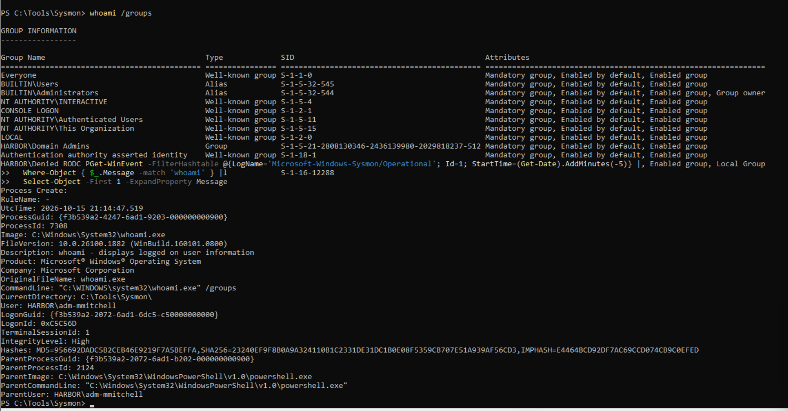

| Field | Why it matters |
| --- | --- |
| CommandLine | Exactly what ran |
| Hashes (SHA256) | A fingerprint; malware renamed `whoami.exe` wouldn't match the real hash |
| ParentImage | What launched it ("Word launched PowerShell" is a classic attack sign) |
| User / IntegrityLevel | Who ran it, and whether elevated |

## 3. The SIEM (Wazuh)

A **SIEM** (Security Information and Event Management) collects logs from every machine into one place and raises alerts on the ones that matter. Wazuh is free and open source, includes alerting, and ships as a ready-made VM.

### Build

- Downloaded the Wazuh 4.14.9 OVA and **verified its SHA512 hash** against the published value before importing. Installing a server that will see every log on the network is exactly when supply-chain verification matters.

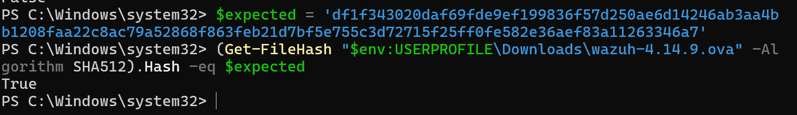

- Imported as **WAZUH01**: 4 vCPU, 8 GB RAM, VMSVGA graphics, hardware clock in UTC (so log timestamps line up across machines), on **CORP-LAN only**.

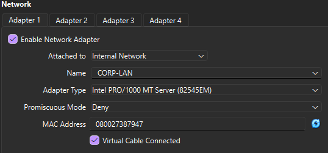

- Gave it a **static IP** (`172.16.0.10`) by editing `/etc/systemd/network/20-eth0.network`, since agents need a server address that never changes. Backed up the file first and read it before applying, which caught two typos (`[Match}` and a lowercase `type=`) that would have dropped the network.

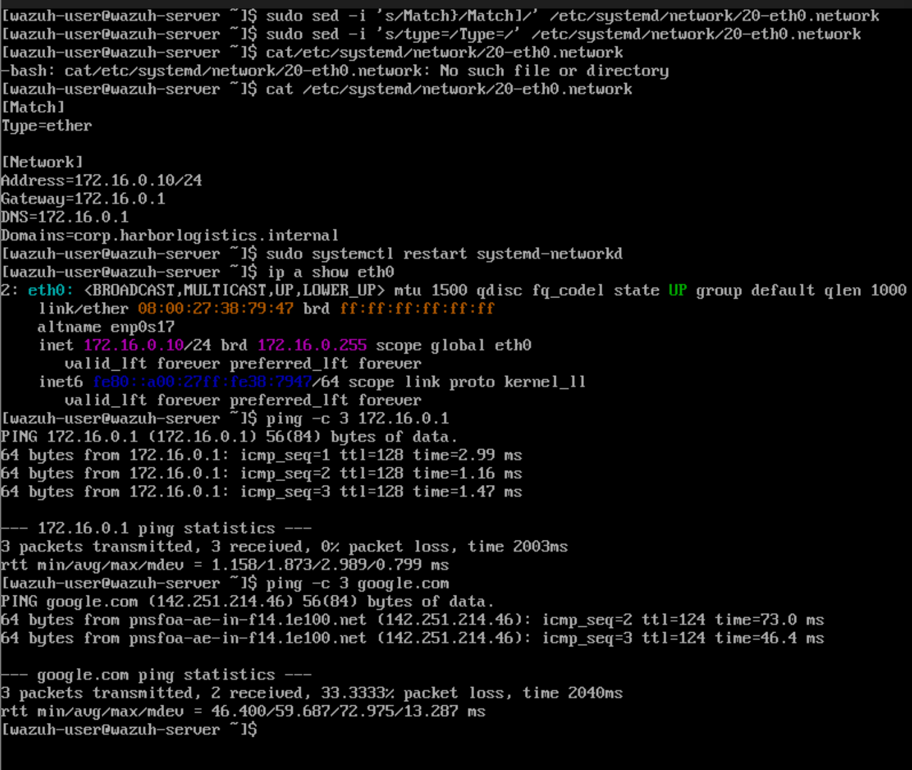

- Added a **DNS A record** `wazuh01` on DC01 and released the stale DHCP lease.

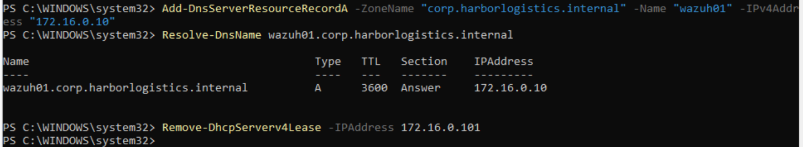

- **Changed the default passwords.** The OVA ships with the same public default credentials on every copy (`admin`/`admin` for the dashboard, `wazuh-user`/`wazuh` for the VM); leaving them is a well-known breach vector. New passwords are stored in a password manager, not here.

### Dashboard

Reached from WS01's browser at `https://wazuh01.corp.harborlogistics.internal`. The browser warns about the certificate because Wazuh uses a self-signed cert; in production this would be replaced with one from the company's own certificate authority.

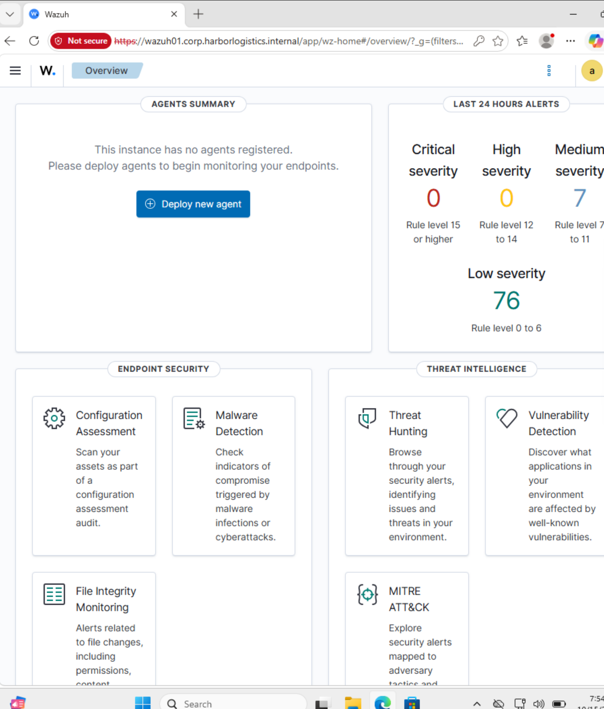

## 4. Connecting the endpoints (agents)

A Wazuh **agent** is a small program on each machine that ships its logs to the server. Installed on DC01 and WS01, verifying the installer's signature (Wazuh, Inc.) first.

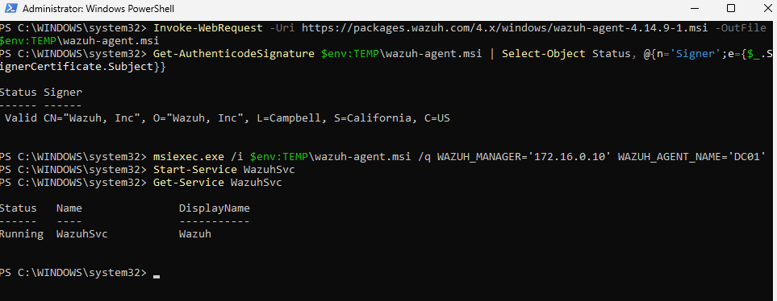

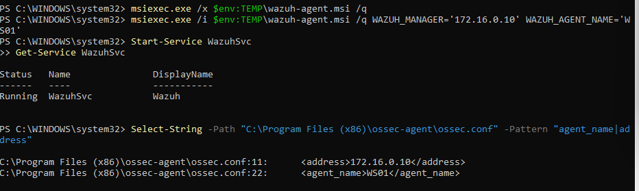

By default Windows agents only forward the Security, System and Application logs. One config file on the server (the `default` group's `agent.conf`) tells every agent to also collect the **Sysmon** and **PowerShell** logs, the best evidence from Steps 2 and 3. Set once centrally, pushed to all agents, like a GPO.

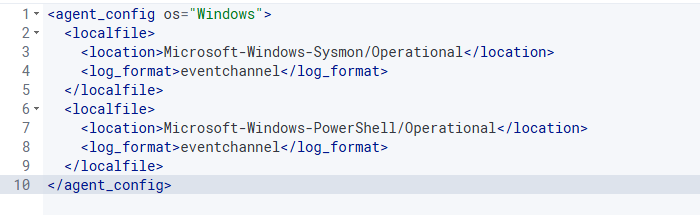

WS01's agent log confirmed it picked up both new channels (`Analyzing event log: 'Microsoft-Windows-Sysmon/Operational'` and the PowerShell channel) within minutes.

## 5. End-to-end test: catching a failed logon

A SIEM only earns its keep if events actually flow through it and surface as alerts. To prove the whole pipeline, I generated failed sign-ins for `jreyes` on WS01, then searched the dashboard.

Wazuh matched **rule 60122, "Logon Failure – Unknown user or bad password," level 5**, with six hits from agent WS01:

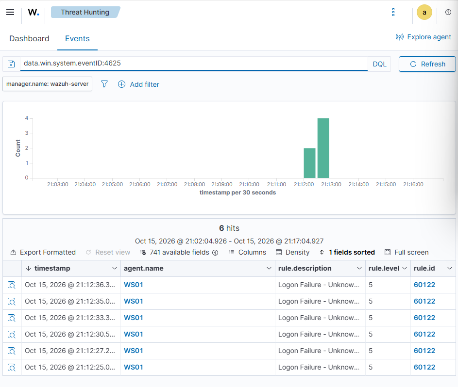

Reading it like an analyst, the data told a fuller story than expected. Expanding event 4625 showed status `0xC0000234` — **account locked out** — not a plain bad password (`0xC000006A`). So some of those failures were attempts against an already-locked account.

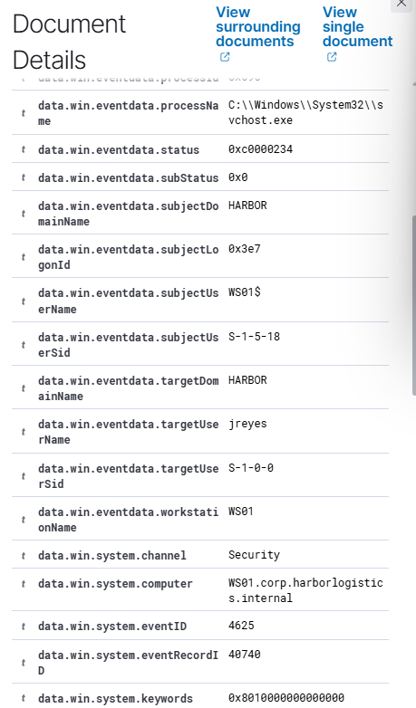

Wazuh had also received **event 4740 from DC01**: `jreyes` locked out, caller computer WS01. The SIEM correlated the failures seen on WS01 with the lockout recorded on DC01, **without me querying the domain controller by hand**. That cross-machine correlation is the entire reason a SIEM exists.

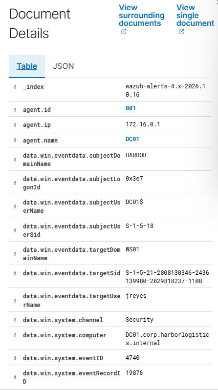

## 6. Troubleshooting

Several real-world issues came up and were worked from the logs:

**"Access denied" setting a DNS record as a Domain Admin.** `Add-DnsServerResourceRecordA` failed with WIN32 5. `whoami /groups` showed **Medium Mandatory Level** and `Domain Admins` marked "Group used for deny only" — the window wasn't elevated, so UAC had stripped the admin token. Reopening PowerShell as administrator fixed it. (As the built-in Administrator the day before, this never happened, because UAC doesn't restrict that account.)

**Wazuh password change reported "Could not load the changes."** The passwords tool ran before the indexer had finished starting. Confirmed the indexer was up and healthy, re-ran the tool successfully, then cleared the shell history so the password wasn't stored in it.

**WS01 agent stuck "Disconnected" with "Duplicate agent name."** The first install on WS01 reused DC01's command (wrong agent name), so I uninstalled and reinstalled it as WS01 — but the uninstall deleted the agent's key while the manager still had WS01 registered. The agent's own `ossec.log` named the cause exactly. Removed the stale registration on the server with `manage_agents -r`, and the agent re-enrolled on its own.

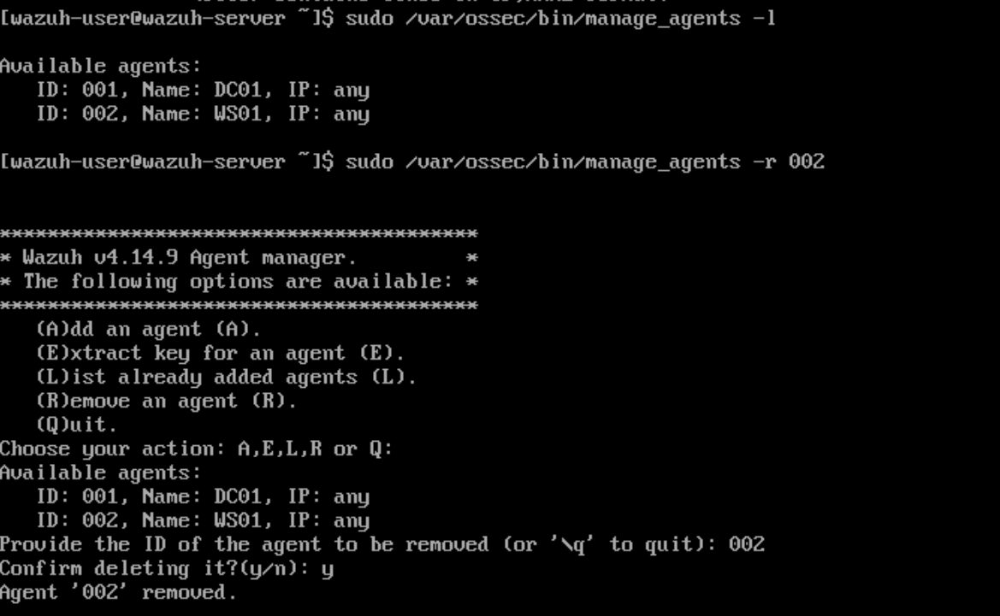

**Linux lesson, logged for honesty:** most of the Wazuh work was on Linux (systemd-networkd, `sed`, `systemctl`), new territory after four Windows phases. The concepts were straightforward; the friction was mechanical — case sensitivity (`Type` vs `type`), look-alike options (`-l` vs `-1`), and no copy-paste into the VM console. Reading each config file before applying it caught the mistakes before they broke anything.

## Result

| Capability | Proven by |
| --- | --- |
| Detailed Windows auditing | `auditpol` on both machines; 4688 with command line; 4104 with script block |
| Rich endpoint telemetry | Sysmon Event 1 with hash and parent process on both machines |
| Central collection | Two agents reporting to Wazuh; Sysmon + PowerShell channels forwarded |
| Alerting and correlation | Failed logon surfaced as rule 60122; SIEM correlated WS01 failures with the DC01 lockout |

## Next

Detection engineering: tuning and writing Wazuh rules so patterns like repeated failed logons, account lockouts, and new privileged-group members raise higher-severity alerts automatically. Hands-on attack investigation is being built separately on dedicated blue-team platforms (TryHackMe SOC path, LetsDefend, Blue Team Labs Online), which provide safe, graded incident scenarios in a SIEM workflow.
