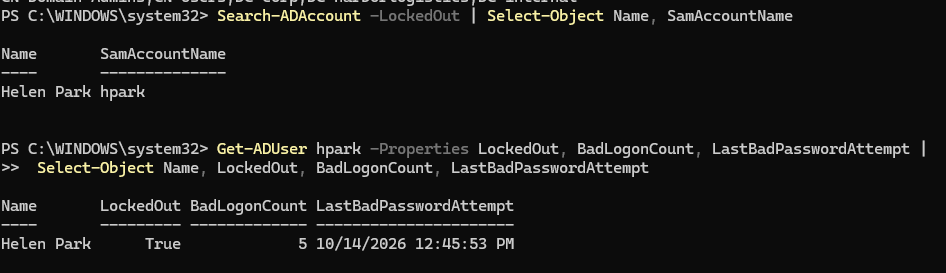
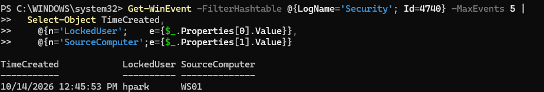
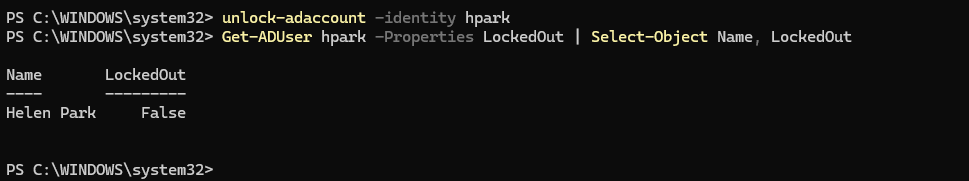

# Ticket 001: Account locked out

| Field | Detail |
| --- | --- |
| Reported by | Helen Park (Finance Manager), `hpark` |
| Report | "My computer says my account is locked." |
| Priority | High (user can't work) |
| Resolved by | `adm-mmitchell` |

## Triage

Six wrong passwords for `HARBOR\hpark` at WS01's sign-in screen produced "The referenced account is currently locked out." Then I confirmed the lockout and how it happened:

```powershell
Search-ADAccount -LockedOut | Select-Object Name, SamAccountName
Get-ADUser hpark -Properties LockedOut, BadLogonCount, LastBadPasswordAttempt |
  Select-Object Name, LockedOut, BadLogonCount, LastBadPasswordAttempt
```



## Root cause: user error or attack?

Before unlocking, I checked where the failed attempts came from. Event ID 4740 on the domain controller records the locked account and the caller computer:

```powershell
Get-WinEvent -FilterHashtable @{LogName='Security'; Id=4740} -MaxEvents 5 |
  Select-Object TimeCreated,
    @{n='LockedUser';    e={$_.Properties[0].Value}},
    @{n='SourceComputer';e={$_.Properties[1].Value}}
```

| TimeCreated | LockedUser | SourceComputer |
| --- | --- | --- |
| 10/14/2026 12:45:53 PM | hpark | WS01 |



One account, from the user's own workstation, during working hours: consistent with mistyped passwords, not an attack.

**When I would not just unlock:** if the source were a computer the user doesn't use, the time were off-hours, or several accounts locked at once, that points to password guessing or spraying. Then the response is to escalate to security, reset the password, and investigate the source machine.

## Fix

```powershell
Unlock-ADAccount -Identity hpark
Get-ADUser hpark -Properties LockedOut | Select-Object Name, LockedOut
```



## Verify

`LockedOut` returned False and the user signed in.

## Prevention / notes

- Lockout policy (5 attempts, 15-minute lockout) is working as designed; it is what stops online password guessing.
- Phase 5 will forward 4740 and failed-logon events to a SIEM and alert on lockouts from unusual sources or many accounts at once.
