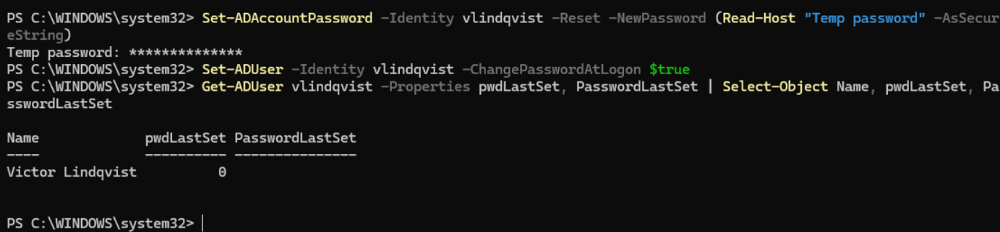

# Ticket 002: Forgotten password

| Field | Detail |
| --- | --- |
| Reported by | Victor Lindqvist (Payroll Specialist), `vlindqvist` |
| Report | "I forgot my password over the weekend." |
| Priority | High (user can't work) |
| Resolved by | `adm-mmitchell` |

## 1. Verify identity first

A password reset hands over access to an account, so the caller has to prove who they are. Impersonating a user to the help desk is a common social engineering attack; the 2023 MGM Resorts breach began with a call like this.

My process:

> In person with photo ID if he's on site. If remote, I'd call back the number on file in HR, not the one he called from, and confirm with his manager. I wouldn't rely on a video call alone because video and voice can be deepfaked.

## 2. Reset with a temporary password

```powershell
Set-ADAccountPassword -Identity vlindqvist -Reset -NewPassword (Read-Host "Temp password" -AsSecureString)
Set-ADUser -Identity vlindqvist -ChangePasswordAtLogon $true
Get-ADUser vlindqvist -Properties pwdLastSet, PasswordLastSet | Select-Object Name, pwdLastSet, PasswordLastSet
```

- `-Reset` sets a new password without the old one (admin only).
- `Read-Host -AsSecureString` keeps the temporary password off the screen and out of command history.
- `ChangePasswordAtLogon` forces the user to choose their own password, so IT never knows the password the user actually uses.
- `pwdLastSet = 0` is how Active Directory stores "must change password at next logon."

The temporary password had to meet the domain policy (14+ characters, complexity), which confirms the policy applies to admin resets too.



## 3. Verify

Signed in to WS01 as `HARBOR\vlindqvist` with the temporary password; Windows required a new password before signing in. After the change, `PasswordLastSet` showed the current date and time:

```powershell
Get-ADUser vlindqvist -Properties PasswordLastSet | Select-Object Name, PasswordLastSet
```

## Prevention / notes

- A self-service password reset with MFA (for example, Microsoft Entra SSPR) would remove most of these calls and the social engineering risk that comes with them.
- Temporary passwords are delivered to the verified user only, never by email or to a third party.
