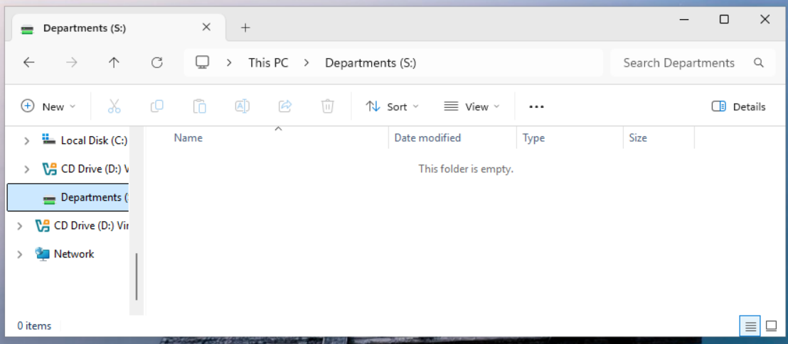
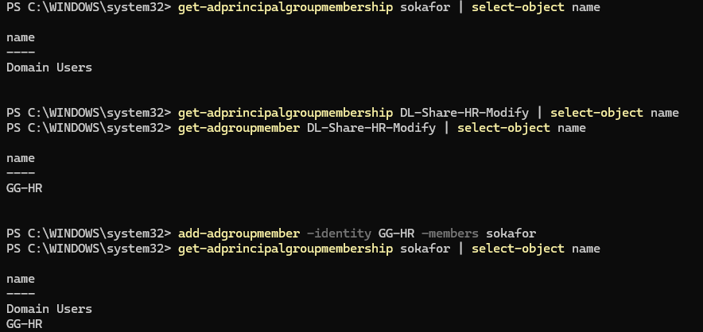
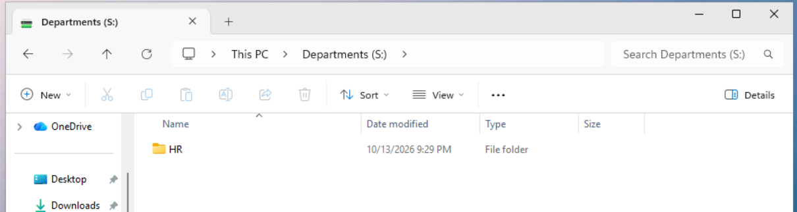

# Ticket 003: Can't see the department folder

| Field | Detail |
| --- | --- |
| Reported by | Sam Okafor (HR Recruiter), `sokafor` |
| Report | "I can't see the HR folder on the S: drive. I need it for onboarding paperwork." |
| Priority | Medium (user is blocked on one task) |
| Approval | Sam is in HR; access to HR's folder matches his role. In production, his manager (Alicia Moreno) confirms in the ticket before any access change. |
| Resolved by | `adm-mmitchell` |

**Simulated cause:** an onboarding mistake. Sam was removed from his department group (`Remove-ADGroupMember -Identity GG-HR -Members sokafor`) to reproduce a user who was never added.

## 1. Reproduce as the user

Signed in to WS01 as `HARBOR\sokafor`. The Departments (S:) drive opened but was empty: Access-Based Enumeration hides folders the user has no permission to open, so to the user the HR folder simply "isn't there."



## 2. Triage: follow the AGDLP chain

Access works like this: **Sam → GG-HR → DL-Share-HR-Modify → Modify on Departments\HR.** I checked each link in order:

```powershell
Get-ADPrincipalGroupMembership sokafor | Select-Object Name   # what groups is Sam in?
Get-ADGroupMember DL-Share-HR-Modify | Select-Object Name      # who is in the permission group?
```

| Link | Result |
| --- | --- |
| Sam → GG-HR | **Broken**: Sam was only in Domain Users |
| GG-HR → DL-Share-HR-Modify | OK: GG-HR is a member |
| DL-Share-HR-Modify → HR folder | Not checked further; the first broken link explains the symptom |



Note: I first ran `Get-ADPrincipalGroupMembership` against the DL group, which answers "what groups is this group in?" and returned nothing. The right cmdlet for "who is in this group?" is `Get-ADGroupMember`.

## 3. Fix through the group, not the folder

```powershell
Add-ADGroupMember -Identity GG-HR -Members sokafor
Get-ADPrincipalGroupMembership sokafor | Select-Object Name
```

I didn't add Sam directly to the folder's NTFS permissions. Access granted to individuals is hard to audit and never gets cleaned up; with AGDLP, moving someone between departments is one group change.

## 4. Verify

A user's group memberships are captured in their access token at sign-in, so Sam had to sign out and back in. After that, the HR folder appeared.



## Prevention / notes

- Bulk onboarding through `scripts/New-HarborUsers.ps1` adds each user to their department group automatically, which prevents this mistake for new hires.
- "User added to group but still has no access" is almost always the old access token: sign out and back in (or restart) before escalating.
