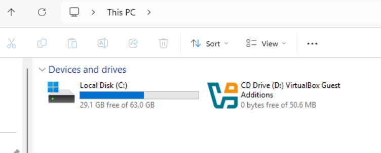
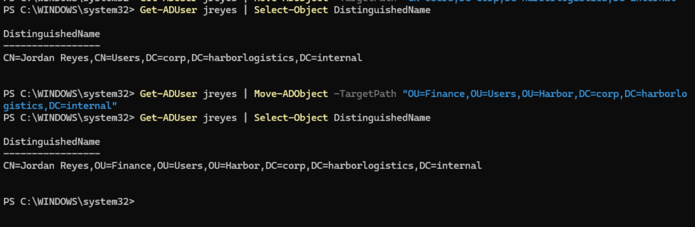
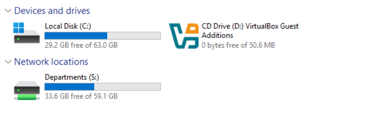

# Ticket 004: Mapped drive missing (Group Policy not applying)

| Field | Detail |
| --- | --- |
| Reported by | Jordan Reyes (Accountant), `jreyes` |
| Report | "Yesterday I had an S: drive. Today it's gone." |
| Priority | Medium |
| Resolved by | `adm-mmitchell` |

**Simulated cause:** the account was moved out of its department OU into the default `CN=Users` container, the way an account ends up in the wrong place after a careless move or when it's created without a path:

```powershell
Get-ADUser jreyes | Move-ADObject -TargetPath "CN=Users,DC=corp,DC=harborlogistics,DC=internal"
```

The drive comes from the GPO **Harbor - User - Drive Maps**, linked to `Harbor\Users`. A GPO only applies to objects inside the OU it's linked to, and `CN=Users` is a built-in container that can't have GPOs linked at all.

## 1. First finding: the drive didn't disappear

After the move, Jordan signed in and S: was still there. `gpresult` showed why:

```
gpresult /r /scope user
```

```
USER SETTINGS
--------------
    CN=Jordan Reyes,CN=Users,DC=corp,DC=harborlogistics,DC=internal
    Last time Group Policy was applied: 10/14/2026 at 6:02:17 PM
    ...
    Applied Group Policy Objects
    -----------------------------
        N/A
    ...
    The user is a part of the following security groups
    ---------------------------------------------------
        Domain Users
        ...
        GG-Finance
        DL-Share-Finance-Modify
```

- User location: `CN=Users` (outside Harbor)
- Applied Group Policy Objects: **N/A** (the Drive Maps GPO was correctly not applying)

The drive was a **leftover**: the mapping had "Reconnect" enabled, so Windows saved it in the user's profile, and it stayed after the GPO stopped applying. That's a security gap, not just a quirk: a user who moves departments would keep a drive mapping to a share they should no longer use. (See the prevention section.)

Same output also showed Jordan still in GG-Finance and DL-Share-Finance-Modify. **OUs decide which policies apply; groups decide which resources a user can access.** Moving the account changed his policies, not his permissions.

To reproduce the reported symptom I removed the saved mapping (`net use S: /delete`) and signed in again: S: was gone.



## 2. Triage

The first two questions for any "GPO isn't applying" ticket:
1. **When did policy last apply?** (the `gpresult` timestamp, so I'm not reading a stale report)
2. **Where does the object live?** (a GPO only reaches objects in the OU it's linked to)

```powershell
Get-ADUser jreyes | Select-Object DistinguishedName
```

`CN=Users`: outside `Harbor\Users`, so the GPO doesn't reach him.

## 3. Fix

```powershell
Get-ADUser jreyes | Move-ADObject -TargetPath "OU=Finance,OU=Users,OU=Harbor,DC=corp,DC=harborlogistics,DC=internal"
Get-ADUser jreyes | Select-Object DistinguishedName
```



## 4. Verify

Jordan signed out and back in: S: returned, and `gpresult /r /scope user` listed **Harbor - User - Drive Maps** again.



## Prevention / notes

- Enabled **"Remove this item when it is no longer applied"** on the drive mapping, so the drive is removed automatically when a user leaves the OU.
- New accounts are created through `scripts/New-HarborUsers.ps1`, which always sets `-Path` to the department OU, so nothing lands in `CN=Users`.
- Option for later: `redirusr` sends accounts created without a path to a Harbor OU instead of `CN=Users` (the same idea as `redircmp`, which I already used for computers).
